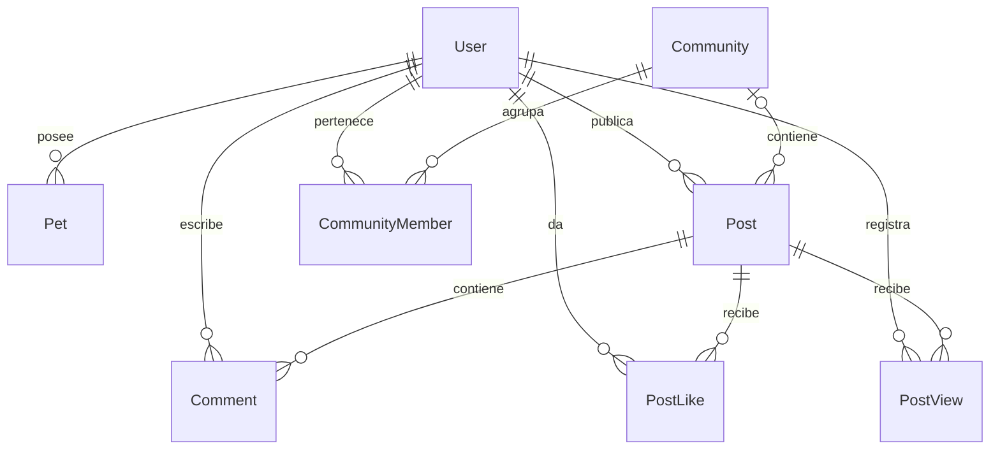

# Petzy — datos y permisos

**Versión documental:** 0.3 · **Revisado:** 19 de octubre de 2026

Inventario transversal de datos y permisos para las capacidades del [mapa](../MAPA-CAPACIDADES.md). Separa el **esquema actual** de las **reglas objetivo**: un modelo o relación existente no implica autorización implementada. Consulte [05-API.md](05-API.md) para rutas y [01-PROYECTO.md](01-PROYECTO.md) para requisitos. Una propuesta de columna o permiso requiere decisión explícita antes de implementarse.

**Cómo leer esta página:** una entidad es un conjunto de datos, como `User` para personas o `Pet` para mascotas. «Permiso objetivo» indica quién debería poder ver o cambiar esos datos; no afirma que el servidor ya lo impida. Si quieres saber qué hará Petzy en pantalla, empieza por [01-PROYECTO.md](01-PROYECTO.md) y la [ficha de la función](ESPECIFICACIONES/00-INDICE.md). Los nombres de tablas se conservan aquí para que el equipo compruebe el código.

Al planificar un flujo de la [ruta secuencial](00-RUTA-DE-DESARROLLO.md), su ficha indica entradas y resultados; esta página muestra las entidades existentes y permisos objetivo. El plan del módulo debe señalar para cada dato su fuente de verdad, relación, dueño, lectura permitida y ciclo de vida. Si una entidad o columna está pendiente, anotarla como decisión abierta con tipo, nulabilidad y migración prevista antes de escribir código.

## 1. Identidad y fuente de verdad

**Supabase Postgres es la base de datos elegida como destino del proyecto.** El esquema Prisma y las migraciones describen las tablas de aplicación; `DATABASE_URL` decide qué instancia PostgreSQL usa cada entorno. En el entorno local revisado el 29-09-2026 apuntaba a `localhost`; el Compose ofrece esa alternativa local aislada. Supabase Auth autentica por correo y contraseña y emite el token. `User.id` en la base conectada corresponde al identificador de esa identidad. El backend verifica el token y coloca `request.user.id`; los registros propios deben relacionarse con ese ID del servidor.

El perfil de aplicación (`User`) guarda nombre de usuario, avatar, biografía, estado de México, fecha de alta y actividad. `email` también aparece en la tabla, por lo que cualquier cambio de correo debe mantener sincronizados Supabase Auth y el perfil en Postgres. La contraseña no es una columna de `User`; no debe agregarse al DTO de edición de perfil. Según D-15, si Auth registra la identidad y falla la inserción del perfil, la persona confirmará su correo, volverá a entrar y completará los datos obligatorios antes de usar el resto de la app; el contrato técnico y sus permisos se diseñan en el plan de `cuenta`.

La decisión D-12 permite cuentas sin filas `Pet`: `User` no requiere una mascota asociada. Feed, comunidades y eventos autorizan por sesión y, según la operación, por membresía o rol; no por existencia de mascotas. No se necesita un rol o columna especial para esta audiencia.

### Qué aporta Supabase y qué existe hoy

| Capacidad | Uso previsto | Estado en el repositorio |
| --- | --- | --- |
| Postgres | Fuente de datos principal de usuarios, mascotas, publicaciones y comunidades. | Esquema Prisma y migraciones; la conexión se elige con `DATABASE_URL`. |
| Auth | Registro, confirmación de correo, acceso, renovación de sesión y recuperación/cambio de credenciales. | Las rutas de Cuenta, la renovación móvil y las pantallas de correo tienen código y pruebas locales; no se ha verificado el flujo integral con Supabase ni en un dispositivo. La recuperación no añade contraseña ni tokens a tablas Prisma. |
| Storage | Fotos de perfil, mascotas, publicaciones y comunidades. | Por integrar; hoy se guardan campos de URL, no hay flujo de carga. |
| Data API | Fuera del acceso directo desde móvil en el MVP (D-134). | No se usa actualmente. Una adopción futura requerirá decisión, contrato, grants y políticas RLS comprobadas antes de exponerse. |
| Realtime | Actualizaciones en vivo de chat, asistencia o interacciones que lo necesiten. | No se usa actualmente. |

Para el MVP, NestJS/Prisma es la única vía de lectura y escritura de datos de aplicación desde el móvil (D-134). Supabase Auth gestiona la identidad; Storage y Realtime se integran según los planes aprobados, sin abrir una segunda escritura de las mismas tablas desde la app. Si se propone cambiar esta arquitectura más adelante, habrá que documentar y comprobar el nuevo contrato antes de sustituir rutas.

En cada operación que pase por NestJS y su conexión Prisma, la API debe seguir comprobando propietario, autor y membresía; no asumir que una política RLS de otro tipo de acceso protege automáticamente esa conexión. Si en una etapa futura se usa la Data API desde la app, definir permisos y políticas RLS y probar casos permitidos y denegados con usuarios diferentes antes de exponerla.

## 2. Entidades actuales

| Entidad | Clave y datos importantes | Relación y restricción actual |
| --- | --- | --- |
| `User` | `id: String`, `email` y `username` únicos; `avatar?`, `bio?`, `locatedAt`, `isActive`. | Propietario de mascotas, publicaciones, comentarios y reacciones; miembro de comunidades. |
| `Pet` | `id: Int`, `ownerId: String`, `name`, `age: Int`, `photo?`, `bio?`, `isActive`. | Muchas mascotas pertenecen a un usuario. Faltan `species` y `breed`. |
| `Post` | `id: Int`, `userId`, `communityId?`, `type`, `title`, `description`, `photoUrl?`, `createdAt`, `isActive`. | Autor obligatorio; comunidad opcional. `photoUrl?` representa hoy una sola foto opcional del post (D-24); no existe carga de archivos integrada. D-19 confirma el vínculo opcional con una mascota propia como objetivo, pero aún no existe relación en el esquema. |
| `Comment` | `id: Int`, `userId`, `postId`, `body`, fechas, `isActive`. | Pertenece a usuario y publicación; índices por publicación/fecha y autor. |
| `PostLike` | Clave compuesta `(userId, postId)`, `createdAt`. | La clave impide dos reacciones iguales de un usuario a una publicación. |
| `Community` | `id: Int`, `name`, `description`, `photoUrl?`. | Tiene miembros y publicaciones; aún no registra tema ni creador explícito. |
| `CommunityMember` | Clave compuesta `(userId, communityId)`, `role`, `joinedAt`. | La clave impide membresías duplicadas. Roles: `ADMIN`, `MODERATOR`, `MEMBER`. |
| `PostView` | Clave `(userId, postId)`, `viewedAt`. | Relaciona usuario y publicación; existe en el esquema de este checkout, aunque falta documentar su uso y permisos. |

`Post.type` admite actualmente `GENERAL`, `TIP`, `QUESTION` y `LOST_PET`; si la app no envía `type`, se usa `GENERAL`. D-21 exige que la persona pueda escoger entre General, Ayuda, Consejo, Pregunta y Mascota perdida. Ayuda será una quinta opción distinta de Pregunta y todavía no existe en el enum; el [plan aprobado de Publicaciones](ESPECIFICACIONES/02-PUBLICACIONES/01-PLAN.md) propone `HELP` y la migración correspondiente. `User.locatedAt` es un estado del enum `MexicoState`, no una ubicación GPS. Los modelos `Event`, `EventAttendance` y `EventNotice` del [plan aprobado de Eventos](ESPECIFICACIONES/09-EVENTOS/01-PLAN.md) no aparecen en este checkout; el estado de bases externas no se comprobó. Tampoco hay modelos de conversaciones, mensajes ni adopción. El [plan aprobado de Adopción](ESPECIFICACIONES/08-ADOPCION/01-PLAN.md) y D-98 definen `AdoptionListing`, `AdoptionPhoto`, `AdoptionReport` y `AdoptionReportPhoto`, separados de `Post`; ninguna tabla está creada todavía. Adopción pertenece al MVP después del chat privado y no añade campos de precio o pago.

## 3. Relaciones y lectura de contenido

La relación de `Post` con `Community` es opcional. Según D-20, `communityId = null` identifica el feed general y es el único contenido de Inicio; un ID presente identifica una publicación comunitaria que solo pueden leer miembros de esa comunidad. El endpoint actual `GET /post` todavía mezcla ambos casos y no comprueba membresía al leer, de modo que esta regla requiere código y pruebas. D-21 añade que «Todas» incluye todas las categorías solo dentro de ese feed general, mientras cada filtro combina `communityId = null` con una categoría concreta. Ambos filtros deben aplicarse en el servidor, también al paginar. El permiso se aplica también al detalle directo, comentarios y reacciones.

D-19 permite vincular opcionalmente una publicación de Inicio o de una comunidad con la ficha activa de una mascota del autor. La publicación muestra nombre, foto disponible y acceso a la ficha como información adicional. Si después se desactiva la mascota, la publicación sigue visible, pero ni su lista ni su detalle entregan ese complemento. D-30 aprobó para el plan `Post.petId Int?`, relación con `Pet.id` e índice; las publicaciones existentes quedarán con `null`. El esquema aún no se ha cambiado. D-89 permite por separado enlazar opcionalmente la ficha propia de un animal en un anuncio de Adopción; D-95 fija nombre, especie, edad calculada, foto y acceso a esa ficha mientras esté activa. D-98 aprueba para el plan un `AdoptionListing.petId Int?` separado de `Post.petId`; ninguna columna existe todavía.

Las columnas `isActive` de usuario, mascota, publicación y comentario permiten desactivación lógica. Las consultas públicas deben filtrar registros inactivos y definir cómo se presenta contenido histórico cuando se desactiva su autor o mascota. Actualmente esa regla no se aplica de forma uniforme a todos los endpoints.

## 4. Matriz de permisos objetivo

| Recurso y operación | Visitante | Usuario autenticado | Propietario / autor | Admin o moderador de comunidad |
| --- | --- | --- | --- | --- |
| Registrarse e iniciar sesión | Sí | Sí | — | — |
| Ver perfil público y buscar usuarios | No por ahora | Sí, campos públicos | Sí, también sus datos privados | Igual que usuario, sin acceso especial al correo |
| Editar perfil o desactivar/reactivar cuenta | No | No para cuentas ajenas | Sí, su propia cuenta; desactivar exige no dejar una comunidad sin administrador | No para cuentas ajenas |
| Ver mascotas | No | Sí, mascotas activas relacionadas con perfiles visibles a usuarios registrados; campos exactos pendientes | Sí | Sin privilegio adicional |
| Crear, editar o desactivar mascota | No | Crear una propia | Editar/desactivar una propia | Sin privilegio adicional |
| Leer Inicio y publicación general | No por ahora | Sí, contenido general activo | Sí, si la publicación está activa | Igual que usuario |
| Leer publicaciones de comunidad y su detalle | No | Solo si es miembro de esa comunidad (D-20) | También requiere membresía | Sí, por su membresía en esa comunidad |
| Crear publicación general | No | Sí | — | — |
| Editar, desactivar o restaurar publicación | No | No la ajena | Puede editar o desactivar la propia; no puede restaurarla por la vía de moderación | `ADMIN`/`MODERATOR` puede desactivar lógicamente una publicación ajena de su comunidad; solo `ADMIN` puede ver y restaurar las retiradas por moderación de esa comunidad. No puede restaurar una retirada por el autor (D-23, D-25). |
| Leer comentarios, comentar y reaccionar | No | Sí en contenido general activo; en comunidad, solo si es miembro (D-20) | Editar/desactivar comentario propio; si es autor de un post general, ocultar y restaurar solo comentarios ajenos que él ocultó; si es autor de un post comunitario, ocultar comentarios ajenos de ese post, pero no restaurarlos (D-56, D-59) | `ADMIN`/`MODERATOR` puede ocultar comentarios ajenos de su comunidad; solo `ADMIN` consulta y restaura los ocultados por ellos o por autores de posts, nunca los retirados por el propio comentarista (D-27, D-28, D-59) |
| Crear comunidad | No | Sí; se convierte en `ADMIN` | — | — |
| Unirse o salir de comunidad | No | Sí, ingreso inmediato salvo bloqueo por expulsión; al salir pierde acceso a posts comunitarios y, antes del inicio de un evento, su «Iré» deja de contar. El total histórico fijado al comenzar no disminuye por salidas posteriores (D-60, D-66, D-68, D-71, D-109) | — | Solo `ADMIN` expulsa a `MEMBER`/`MODERATOR` o quita el bloqueo; el último `ADMIN` activo nombra otro antes de salir (D-62, D-68) |
| Publicar en comunidad | No | Solo si es miembro | Puede editar su publicación | `ADMIN`/`MODERATOR` puede desactivar lógicamente una publicación ajena de esa comunidad; otras facultades pendientes (D-23) |
| Crear evento de comunidad | No | `MEMBER` no puede | Si tiene rol `ADMIN` o `MODERATOR` | Sí, en su comunidad; comprobar rol en la API |
| Ver evento y responder asistencia | No por ahora | Puede ver; confirma solo si es miembro de la comunidad | Igual | Igual; sin respuesta duplicada ni lista nominal pública |
| Editar datos o roles de comunidad | No | No | — | Solo roles autorizados; `MEMBER` no administra |
| Leer y crear publicaciones de adopción | No por ahora | Sí; puede crear sin ficha `Pet` propia | Sí | Sin privilegio adicional confirmado |
| Marcar que la mascota encontró hogar | No | No en publicación ajena | Sí, solo el autor | Moderación adicional por definir |
| Contactar al autor de adopción | No | Sí, mediante chat privado uno a uno | Comportamiento en publicación propia pendiente | Sin privilegio adicional |

Esta matriz es **objetivo**, no certificación del backend. Toda decisión de autorización se comprueba en la API y se vuelve a probar con dos cuentas distintas. Ocultar botones en la app mejora la interfaz, pero no reemplaza el control del servidor.

## 5. Cambios de esquema antes de cada módulo

### Perfil

- Los perfiles y mascotas activas son visibles para usuarios registrados. D-35 fija nombre de usuario, avatar, biografía y estado de México como campos públicos del usuario, junto con mascotas activas; `email`, credenciales y tokens quedan privados para terceros.
- Separar el DTO de edición de perfil del DTO de registro. D-38 aplaza el cambio de correo; no admitir `email` ni `password` en la edición de perfil. La recuperación de contraseña va por Supabase Auth. Si más adelante se permite cambiar correo, diseñar confirmación y sincronización con `User.email`.
- D-36 incluye desactivar y reactivar la cuenta en la primera versión. Mientras `User.isActive = false`, ocultar perfil, mascotas, publicaciones y comentarios, excluir sus «Me gusta» de los conteos y bloquear acceso al contenido aunque exista un token anterior. Los registros permanecen guardados; al reactivar la misma identidad, solo reaparece el contenido que seguía activo individualmente. Si la cuenta es la única administradora de alguna comunidad, exigir nombrar antes a otra persona. D-37 conserva `CommunityMember` y sus roles, pero excluye cuentas desactivadas de listas/conteos y de acceso comunitario; al reactivar recuperan su membresía.
- D-39 confirma una foto de perfil privada JPEG, PNG o WebP de hasta 5 MB, accesible a cuentas activas tras comprobar la sesión. El [plan de Perfiles](ESPECIFICACIONES/03-PERFILES/01-PLAN.md) propone usar `User.avatar` para una referencia interna de Storage, sin nueva columna; la respuesta pública entrega una ruta protegida de API, no la referencia interna. Inventariar valores existentes antes de cambiar su interpretación.
- D-40 fija nombre de usuario de 3–30 caracteres, biografía de hasta 300 y búsqueda por nombre de 2–50 caracteres, paginada de 20 en 20 y con máximo 30 resultados por solicitud. D-41 requiere comprobar otra vez correo y contraseña para reactivar; un token antiguo por sí solo no permite esa acción. No guardar ni registrar esas credenciales en `User`.

### Mascotas

- Añadir `species` y `breed` obligatorios según D-42. D-46 fija selector de Perro, Gato, Ave, Conejo y «Otra» con texto obligatorio para otra especie; D-45 admite «Mestiza» y «Raza desconocida» como respuestas válidas. El [plan aprobado](ESPECIFICACIONES/04-MASCOTAS/01-PLAN.md) los guardará como texto, sin un catálogo cerrado de razas; el esquema actual aún no ha cambiado.
- D-51 sustituyó D-48: eliminar `Pet.age: Int` en la futura migración; nunca aceptar `age` del móvil. El [plan aprobado](ESPECIFICACIONES/04-MASCOTAS/01-PLAN.md) añade `birthYear Int`, `birthMonth Int` obligatorios y `birthDay Int?` opcional: un día vacío significa que solo se conocen mes y año aproximados (D-44), sin inventar una fecha exacta. El backend calculará la edad al entregar cada ficha con el día UTC de referencia, sin guardarla ni programar una actualización diaria (D-52). D-50 fija el texto de edad y nacimiento aproximados. El usuario indicó que no hay datos reales ni despliegue; antes de migrar se revisarán posibles filas de prueba del entorno de desarrollo.
- Conservar `ownerId` como relación obligatoria y asignarlo desde el token; retirarlo del cuerpo de creación y edición.
- La foto es opcional; D-47 fija JPEG, PNG o WebP de hasta 5 MB en Storage privado y entrega por el backend tras comprobar sesión, mascota y dueño activos en cada solicitud. La base almacena la referencia interna y la API no entrega URL pública ni ruta de Storage. D-49 fija nombre, raza y especie «Otra» de 2–50 caracteres y descripción opcional hasta 300. D-43 hace públicos nombre, especie, raza, edad, foto y descripción disponibles y nacimiento exacto cuando se conoce; para el aproximado, mes y año con la etiqueta de D-50. Las mascotas y dueños inactivos no se exponen.

### Feed

- El vínculo opcional de D-19 se representará con `Post.petId Int?` según D-30, con `null` en publicaciones existentes; preparar su migración antes del código. Comprobar propiedad y actividad de la mascota al vincularla, también al reemplazarla durante la edición. Permitir quitar el vínculo. Al leer una publicación, mostrar solo nombre, foto disponible y acceso a la ficha si la mascota continúa activa; si se desactiva, conservar la publicación sin exponer ese complemento.
- Separar Inicio (`communityId = null`) de las publicaciones comunitarias. Comprobar membresía en servidor al listar, abrir por ID o consultar interacciones de una publicación con `communityId`; paginar por un orden estable (`createdAt` más `id`, por ejemplo).
- Añadir la quinta categoría Ayuda al enum de `Post.type` mediante migración revisada; conservar las categorías de publicaciones existentes. Aplicar en la consulta paginada de Inicio el filtro opcional de categoría junto con `communityId = null` (D-21).
- Limitar la edición por el autor a título, descripción, foto, categoría y mascota vinculada; permitir retirar foto y mascota. Rechazar cambios de `userId` o `communityId` aunque el cliente los envíe. El DTO actual permite editar `communityId`, contrario a D-22.
- Conservar una sola foto opcional propia del post (D-24). Al reemplazarla o retirarla, la respuesta de lista y detalle refleja la imagen vigente o su ausencia. La foto de la ficha de mascota vinculada es otro dato y no cuenta para este límite. D-32 y D-33 fijan Storage privado, descarga por backend con permiso comprobado en cada solicitud y JPEG, PNG o WebP hasta 5 MB. El [plan](ESPECIFICACIONES/02-PUBLICACIONES/01-PLAN.md) detalla carga y tratamiento del archivo anterior; la migración de URL existentes requiere inventario.
- Para moderar una publicación comunitaria, comprobar `Post.communityId` y el rol `ADMIN` o `MODERATOR` vigente de quien solicita la acción en esa misma comunidad. Cambiar `isActive` a `false` y conservar la fila; las lecturas normales, incluido el detalle por ID, deben excluirla. No conceder por ese rol edición de contenido ajeno ni desactivación de publicaciones de Inicio u otras comunidades (D-23). Diseñar antes del código cómo registrar autor y momento de la acción.
- La pestaña administrativa de cada comunidad consulta solo publicaciones retiradas por moderación en esa comunidad; únicamente `ADMIN` puede verla y cambiar `isActive` de `false` a `true` para restaurarlas. Excluir publicaciones retiradas por su propio autor tanto de la pestaña como de la restauración (D-25). `isActive` por sí solo no permite distinguir los dos orígenes. D-31 aprobó para el plan la tabla separada `ModerationRemoval`; no hay nueva columna en `Post` ni cambio de esquema aplicado.
- Al desactivar una publicación, conservar sus filas `Comment` y `PostLike`, sin mostrarlas ni aceptar nuevas lecturas o escrituras de interacción mientras `Post.isActive = false`. Si el administrador restaura una publicación retirada por moderación, vuelven a verse los comentarios con `Comment.isActive = true` y los likes anteriores, sin duplicarlos. Los comentarios desactivados individualmente por su autor o por moderación continúan ocultos (D-26, D-27).
- Para desactivar un comentario ajeno por moderación, comprobar que `Comment.postId` corresponde a una publicación de la comunidad donde quien actúa tiene rol `ADMIN` o `MODERATOR`, o que el ID del token coincide con `Post.userId` del post y su membresía sigue vigente (D-59). Establecer `Comment.isActive = false` y conservar la fila y el texto sin alterarlos. Ninguno de esos permisos permite editar comentarios ajenos ni moderar los de Inicio u otra comunidad (D-27).
- Solo `ADMIN` puede consultar y restaurar comentarios ajenos retirados en su comunidad por administradores, moderadores o autores de posts. Excluir los retirados por su autor de la vista y de la restauración; al restaurar, cambiar `Comment.isActive` a `true`, sin modificar el texto. La visibilidad normal también exige que la publicación esté activa y que el lector sea miembro (D-28, D-59). `Comment.isActive` por sí solo no distingue el origen de la retirada: D-31 lo resuelve en el plan mediante `ModerationRemoval`, aún sin implementar.
- Para un post general (`Post.communityId = null`), D-56 permite a su autor ocultar comentarios ajenos y ver solo los que él ocultó en «Comentarios ocultados» de ese post. Puede restaurarlos individualmente. El backend compara `Post.userId` con el ID del token y verifica `Comment.postId` antes de cada acción; el dueño del comentario no obtiene permiso para la vista del autor. La retirada cambia `Comment.isActive` a `false` y conserva texto y registro; D-58 aprobó reutilizar `ModerationRemoval` de D-31 para registrar el origen y la restauración.
- Verificar que el autor de un comentario o reacción sea el usuario del token y que la publicación esté activa y sea visible para él.
- Mantener la unicidad de `PostLike` y aplicar D-26: conservar comentarios y reacciones al desactivar una publicación, pero no mostrarlos ni aceptar cambios mientras esté oculta.
- D-53–D-55 fijan comentarios solo de texto con contenido de hasta 500 caracteres, sin fotos ni respuestas anidadas; lectura del más reciente al más antiguo, 20 por página y máximo 30. La respuesta pública muestra nombre de autor, referencia protegida de foto si existe, texto, fecha e `editedAt` opcional como indicador de edición (D-57); mostrar «Editado» solo si no es `null`, sin correo. El autor puede editar el suyo en cualquier momento mientras comentario y publicación estén activos y conserve acceso. Al planificar, usar fecha e ID para ordenar sin duplicados entre páginas y validar el límite en el servidor.

### Comunidades

- El tema escrito es obligatorio y forma parte de la búsqueda (D-63, D-67). El esquema actual no tiene ese campo; el [plan aprobado de Comunidades](ESPECIFICACIONES/06-COMUNIDADES/01-PLAN.md) define `Community.topic String` y su migración futura (D-74). El nombre no necesita ser único entre comunidades (D-72). Nada se ha migrado todavía.
- Crear `Community` y su `CommunityMember(ADMIN)` en una misma transacción para evitar comunidades sin administrador. D-60 permite unirse de inmediato como `MEMBER` sin aprobación y sin duplicar la clave compuesta.
- D-61 permite a cualquier cuenta activa no expulsada ver nombre, descripción, foto disponible y conteo de miembros activos antes de unirse, sin acceso a posts. D-62 bloquea la salida del último `ADMIN` activo hasta que nombre otro, incluso ante salidas simultáneas. D-63–D-70 fijan tema escrito, foto privada, roles, salida conservando contenido, límites, expulsión y bloqueo de reingreso. Una persona expulsada no recibe ningún dato de esa comunidad, incluida foto o eventos, aunque conozca el ID; al quitar el bloqueo recupera la vista previa y los eventos, y debe unirse para leer posts o confirmar asistencia. Todos los miembros activos ven una lista paginada de miembros activos con nombre, foto y rol, sin correo. D-73 permite al `ADMIN` editar nombre, descripción, tema y foto. D-74 aprueba `CommunityExpulsion` para persistir bloqueos; esa tabla aún no existe en el esquema.
- Al crear o leer una publicación comunitaria, comprobar membresía en el servidor; no confiar solo en `communityId` ni en que la pantalla oculte la publicación.
- En el detalle de cada comunidad separar «Publicaciones» (`Post.communityId`) de «Eventos» (`Event.communityId`). Solo `ADMIN` y `MODERATOR` pueden crear eventos; comprobar su rol en el servidor.

## 6. Modelos pendientes: chat y adopción en el MVP; eventos después

**Eventos:** `Event`, `EventAttendance` y `EventNotice` son tres modelos aprobados para el [plan técnico](ESPECIFICACIONES/09-EVENTOS/01-PLAN.md); aún no existen en este checkout (D-115–D-116). `Event` pertenecería a `Community` y guardaría creador, textos, portada opcional, inicio, fin aproximado obligatorio con zona, lugar, punto, estado y `confirmedCountAtStart Int?`. `EventAttendance` tendría combinación única `(eventId, userId)`, respuesta y fecha opcional de invalidación. `EventNotice` conservaría avisos por cambios y cancelación para cada destinatario. Antes del inicio, el conteo de «Iré» incluye solo miembros con cuenta activa y respuesta vigente; salir, ser expulsado o desactivar la cuenta lo invalida y exige confirmar otra vez tras regresar o reactivar (D-71, D-117). Al comenzar, se cierra la asistencia y se fija el total histórico, que no disminuye por salidas posteriores (D-106, D-109). La API exigirá membresía para confirmar y para gestionar un evento como creador; ocultará la comunidad y sus eventos a la persona expulsada (D-70, D-119). Un cancelado pasa enseguida a «Eventos anteriores» y oculta el total (D-103, D-118). El registro de migración local en documentos anteriores no se verificó contra una base en esta revisión. Véase [ESPECIFICACIONES/09-EVENTOS.md](ESPECIFICACIONES/09-EVENTOS.md).

**Chat privado (MVP propuesto):** `Conversation` y `Message` todavía no existen. La conversación representará un par de cuentas sin duplicados; cada mensaje guardará conversación, remitente, texto y fecha. La API comprobará la participación antes de cada lectura y escritura. D-76 exige que un bloqueo detenga envíos en ambos sentidos sin quitar el historial anterior; solo quien bloqueó puede deshacerlo. D-79 fija mensajes de hasta 250 caracteres, avisos e indicadores. D-82 guarda la visibilidad por participante para que «Borrar chat para mí» retire mensajes anteriores solo de su vista. **D-87 confirma `ChatReport` para reportes enviados durante el MVP**; D-88 añade `ChatReportMessage` para referenciar los mensajes originales seleccionados sin copiar su texto. Cada reporte y sus mensajes referenciados se conservan al menos hasta que el equipo revise ese reporte en la futura web, sin borrado automático anterior. No habrá API de lectura administrativa. Las tablas de personal, los registros de suspensiones y `User.suspendedUntil` quedan para después. El bloqueo entre participantes no cambia el acceso general de ninguna cuenta.

**Sistema web futuro del equipo:** D-87 conserva el envío y almacenamiento de reportes en el MVP, pero traslada a la etapa web su lectura por personal, revisión y posibles suspensiones. `PetzyStaff`, `AccountSuspension` y `User.suspendedUntil DateTime?` quedan fuera de las migraciones del MVP de Chat. La API administrativa y sus permisos se especificarán para una [aplicación web independiente](FUTURO/DASHBOARD-WEB-PETZY.md), con framework aún sin elegir. D-88 fija la conservación de cada reporte hasta que se revise; la política posterior se acordará en la etapa web.

**Adopción:** se integra después del chat uno a uno. D-98 aprueba `AdoptionListing`, `AdoptionPhoto`, `AdoptionReport` y `AdoptionReportPhoto` como tablas nuevas separadas de `Post`; el [plan aprobado](ESPECIFICACIONES/08-ADOPCION/01-PLAN.md) detalla sus tipos, relaciones, índices y migración, aún sin aplicar. El autor del token publica un animal con título/descripción obligatorios de hasta 120/3 000 caracteres y una a tres fotos JPEG, PNG o WebP de hasta 5 MB cada una; puede enlazar una ficha propia sin necesitarla y es el único que puede editar título, descripción, fotos, vínculo o estado, retirar voluntariamente el anuncio con borrado lógico y restaurarlo desde su vista privada con el estado anterior (D-89–D-97). Si enlaza ficha, solo se entregan nombre, especie, edad calculada, foto disponible y acceso a la ficha mientras siga activa; el anuncio persiste sin ese complemento cuando se desactiva. La vista conjunta muestra primero «Busca hogar» y después «Encontró hogar», con filtros por estado; uno retirado deja de mostrarse y no se abre por ID desde otra cuenta. Un anuncio «Encontró hogar» sigue visible, pero no ofrece contacto nuevo desde Adopción. Las fotos se guardarán privadas: en cada entrega se comprobará sesión y acceso al anuncio; el retirado y sus fotos solo son visibles para su autor. El MVP guardará un reporte por persona y anuncio ajeno visible, con uno de cuatro motivos obligatorios y explicación opcional de hasta 500 caracteres; un nuevo intento devuelve «Ya lo reportaste». Cada reporte guarda copia de título, descripción y estado, más referencias a las fotos privadas para entenderlo aunque el anuncio se edite o retire; se conservará al menos hasta su revisión en la web futura. No habrá consulta ni revisión administrativa en el MVP. No hay comentarios ni «Me gusta» en anuncios de Adopción durante el MVP; las operaciones de Publicaciones deben rechazarlos. El formulario no tiene precio/pago y exige confirmar «Solo adopciones, no ventas». Véase [08-ADOPCION.md](ESPECIFICACIONES/08-ADOPCION.md).

Los chats grupales y la CNN quedan fuera de esta primera estructura. Si se implementa la CNN, la raza sugerida será editable y distinguible de un dato confirmado por el dueño.

## 7. Brechas de permisos detectadas en el código actual

- `POST/PATCH/DELETE /pet` no comprueban aún que el solicitante sea el dueño. El DTO de mascota valida `ownerId` con `@IsInt()` pese a que es `String` en Prisma.
- `PATCH/DELETE /user/:id` no limitan la operación a la cuenta autenticada. El DTO de edición hereda `password`, aunque `User` no tiene esa columna.
- `GET /user/search` devuelve usuarios completos y puede exponer correo. `GET /user/:id/pets` acepta cualquier ID y no filtra mascotas inactivas.
- `POST /post` admite `communityId` sin comprobar membresía. `GET /post` no separa feed general y comunidades ni filtra por categoría. El DTO actual acepta una de las cuatro categorías del enum y el esquema usa General si se omite; falta Ayuda y la selección móvil (D-21).
- El guard de propietario de comentarios tiene una validación de ID que debe corregirse antes de considerar protegida la edición o eliminación.
- El guard global verifica la firma del token, pero su configuración actual no establece comprobaciones explícitas de emisor y audiencia. Revisar estos valores con la configuración de Supabase antes de publicar la API.

## 8. Migraciones y verificación por módulo

Cada cambio de modelo debe tener una migración versionada y una actualización del contrato de API. En desarrollo, aplicar `prisma migrate dev` y ejecutar después `prisma generate` de forma explícita. Revisar el SQL cuando se cambien campos obligatorios o relaciones con datos existentes.

Pruebas mínimas de permisos con dos cuentas: A crea el recurso; B intenta editarlo y debe recibir una denegación; A lo edita; al desactivarlo deja de aparecer en los listados normales. Para comunidades, probar miembro y no miembro. Los resultados y las excepciones se anotarán en este documento al completar cada módulo.

## 9. Referencias oficiales de Supabase

- [Conectar Prisma con Supabase Postgres](https://supabase.com/docs/guides/database/prisma).
- [Data API generada desde PostgreSQL](https://supabase.com/docs/guides/api) y [seguridad con permisos y RLS](https://supabase.com/docs/guides/api/securing-your-api).
- [Supabase Storage](https://supabase.com/docs/guides/storage) para archivos e imágenes.
- [Supabase Realtime](https://supabase.com/docs/guides/realtime) para eventos en vivo.
