# Documento de diseño de interfaces — Petzy

**Versión:** 2.3 · **Fecha:** 19 de octubre de 2026 · **Estado:** recorridos y pantallas revisados; las pantallas de Cuenta tienen una primera implementación visual pendiente de revisión en dispositivo.

## 1. Introducción y objetivo

Petzy es una aplicación móvil para personas con mascotas y para quienes disfrutan conocerlas aunque no tengan una propia. Este documento registra lo que se puede observar en **una imagen de referencia del feed** enviada por el usuario, la paleta que compartió y sus decisiones posteriores sobre navegación y filtros. Sirve de base visual para el trabajo futuro. No demuestra que la pantalla ya exista o funcione en la app.

**Fuentes visuales:** [pantalla de referencia](imagenes/diseno/referencia-feed-petzy.png) y [paleta proporcionada](imagenes/diseno/paleta-natural-petzy.png). La primera es una imagen estática de un teléfono; la segunda muestra muestras de color con códigos HEX. No se proporcionó un prototipo navegable ni capturas de otras pantallas. Las fichas de [Publicaciones](ESPECIFICACIONES/02-PUBLICACIONES.md) y [diseño transversal](ESPECIFICACIONES/90-DISENO-APP.md) son fuentes separadas de requisitos futuros; no convierten el comportamiento de esta imagen en una función implementada.

**Regla de lectura:** «Referencia» describe lo visible en el PNG; «Acordado» describe una decisión posterior del usuario; «Propuesta de patrón» indica una recomendación documentada, pendiente de revisión o comprobación. Ninguna de las tres etiquetas significa «implementado». No habrá prototipo navegable previo: las tareas de todos los módulos deben estar definidas y el usuario debe autorizar expresamente el inicio del código (D-123).

## 2. Lineamientos visuales

**Observable en la referencia:** fondo claro de tono cálido, predominio del verde natural, tarjetas claras con esquinas redondeadas, fotografías de mascotas destacadas y una presentación de contenido con poco ruido visual. El nombre «Petzy» aparece centrado y con letra decorativa. La pantalla transmite cercanía sin llenar de adornos el contenido.

**Acordado:** usar un verde medio para títulos y un negro casi puro para textos en modo claro; usar Nunito para los textos de la interfaz y reservar la letra decorativa para el logotipo «Petzy» (D-127). La imagen no permite deducir por sí sola qué color exacto se aplicó a cada elemento ni muestra un modo oscuro; este último se acordó después (D-125). Las fotografías y el texto de cada publicación deben conservar prioridad frente al logotipo y los controles.

**Ajuste de Cuenta, 19 de octubre de 2026:** el título de cada pantalla de acceso tiene más tamaño y peso visual que la marca «Petzy». El fondo incorpora círculos suaves con colores ya aprobados, detrás del formulario y sin función interactiva. Este ajuste se aplica al componente compartido de las pantallas de Cuenta; debe revisarse en un teléfono antes de considerarlo definitivo. La skill local [`frontend-design`](../.agents/skills/frontend-design/SKILL.md) se leerá antes de crear o rediseñar cada pantalla para orientar jerarquía, composición y texto, conservando las decisiones visuales y funcionales de Petzy.

## 3. Paleta de colores

Los siguientes HEX **sí aparecen escritos en la paleta proporcionada**. Su asignación es una propuesta de uso, salvo las preferencias de verde medio para títulos y negro para texto indicadas por el usuario. No se han extraído colores de píxeles de la pantalla ni comprobado que el mockup use exactamente estos códigos.

| Color de la fuente | HEX | Función sugerida o indicada | Estado |
| --- | --- | --- | --- |
| Verde medio | `#48741C` | Títulos y selección principal. | Preferencia indicada por el usuario; contraste por verificar en cada fondo. |
| Verde natural | `#4C793C` | Alternativa para acciones o acentos de marca. | Propuesta; uso exacto por definir. |
| Verde suave | `#82A87E` | Detalles secundarios. | Propuesta; no usar como texto sin comprobar contraste. |
| Café | `#947440` | Acentos discretos relacionados con las mascotas. | Propuesta; uso exacto por definir. |
| Beige | `#DED0A5` | Superficies o detalles cálidos. | Propuesta; el fondo exacto del mockup no está verificado. |
| Verde grisáceo claro | `#DBDFD0` | Posible fondo o separación entre superficies. | Propuesta; uso exacto por definir. |
| Negro casi puro | `#111212` | Texto principal. | Preferencia indicada por el usuario. |

### Modo oscuro acordado (D-125)

Es una **dirección de diseño aprobada por el usuario**, no un modo visible en la captura ni implementado en la app. Conserva la misma distribución del modo claro y deja las fotos de mascotas a todo color, sin un tinte verde encima. Usa colores de las paletas que proporcionó el usuario:

| Uso en modo oscuro | HEX | Aplicación prevista |
| --- | --- | --- |
| Fondo principal | `#182213` | Superficie general verde muy oscura, sin recurrir a negro puro. |
| Tarjetas y menús | `#20311C` | Superficie ligeramente más clara que el fondo. |
| Texto principal | `#DBDFD0` | Párrafos, nombres y contenido que debe leerse con facilidad. |
| Títulos y selección | `#82A87E` | Encabezados y opción activa; no usar el verde medio `#48741C` como texto sobre este fondo oscuro. |
| Acento cálido | `#BC9C6F` | Detalles puntuales, sin competir con las fotografías. |
| Botón principal | Fondo `#82A87E`; texto `#182213` | Acción destacada con etiqueta siempre visible. |

**Contraste calculado a partir de estos HEX:** `#DBDFD0` sobre `#182213` ≈ **12.12:1** y sobre `#20311C` ≈ **10.20:1**; `#82A87E` sobre `#20311C` ≈ **5.17:1**; texto `#182213` sobre botón `#82A87E` ≈ **6.15:1**. La comprobación en pantallas reales, incluidos iconos, bordes y estados, sigue pendiente. El color `#525D48` puede servir de separador decorativo, pero su contraste sobre `#182213` (≈ **2.36:1**) no basta por sí solo para delimitar un control interactivo.

**Selección de tema acordada (D-126):** Petzy seguirá el tema del teléfono de forma predeterminada y permitirá elegir manualmente Claro u Oscuro desde «Ajustes», además de volver a «Automático». El cambio aplicará a toda la app. El [plan de Diseño aprobado](ESPECIFICACIONES/90-DISENO-APP/01-PLAN.md) propone guardar la preferencia con una dependencia ya instalada; todavía no se ha implementado ni verificado en dispositivos.

### Colores de estado acordados (D-128)

Estos colores son **decisiones posteriores del usuario**; no se observan en la captura. Se usarán de forma discreta junto a un mensaje o icono comprensible, nunca como única señal del resultado.

| Estado | Modo claro | Modo oscuro | Uso previsto |
| --- | --- | --- | --- |
| Error | Rojo tierra `#8C3F37` | Rojo tierra claro `#F0A59A` | Mensaje junto al campo o acción que falló; conservar datos y ofrecer corrección o reintento. |
| Éxito | Verde profundo `#365625` | Verde suave `#82A87E` | Confirmar una acción solo cuando el servidor respondió correctamente. |
| Aviso | Café oscuro `#665524` | Beige cálido `#DED0A5` | Información que requiere atención sin presentarla como error. |
| Foco | Verde medio `#48741C` | Verde suave `#82A87E` | Borde o indicador visible del control activo, acompañado de su etiqueta. |

**Contraste calculado para texto de estado:** error, éxito y aviso en modo claro superan **4.5:1** sobre `#DBDFD0` y `#DED0A5`; sus variantes oscuras superan **5:1** sobre `#20311C`. El foco claro supera **3:1** sobre ambos fondos claros citados y el oscuro supera **5:1** sobre la tarjeta oscura. Son cálculos de los HEX, no pruebas en dispositivos. Cada componente deberá comprobarse sobre su fondo real antes de implementarse.

**Botón deshabilitado acordado (D-129 y D-130):** conservará su etiqueta legible y la misma forma que el botón activo, pero usará una superficie neutra en lugar del verde de acción. En modo claro tendrá fondo oliva suave `#B5AF8B` y texto `#111212`; en modo oscuro, fondo gris verdoso `#404F4D` y texto `#DBDFD0`. Si no es evidente por qué no puede pulsarse, aparecerá una explicación breve junto al control; por ejemplo, «Escribe un título para publicar». No se distinguirá únicamente por menor opacidad. Los contrastes calculados de texto y fondo son aproximadamente **8.46:1** en claro y **6.33:1** en oscuro. Habrá que revisar cada botón en su pantalla real. La imagen de referencia no muestra este estado.

**Comprobación para la paleta propuesta:** calculando el contraste según WCAG, `#48741C` sobre `#DBDFD0` da aproximadamente **4.08:1** y sobre `#DED0A5` aproximadamente **3.61:1**; estas combinaciones sirven para títulos grandes, pero no alcanzan el mínimo **4.5:1** de texto normal. `#111212` sobre esos fondos supera 12:1. Por tanto, el verde medio no se aplicará indiscriminadamente a texto pequeño: cada combinación definitiva se medirá antes de usarla. Las cifras son cálculos de las muestras proporcionadas, no una medición de la captura. Véase [WCAG 2.2, contraste mínimo](https://www.w3.org/WAI/WCAG22/Understanding/contrast-minimum.html).

## 4. Tipografía

**Ajuste solicitado el 25-10-2026:** en Inicio, «Petzy» se amplía de 19 a 38 puntos con interlínea de 50 y usa `Nunito_700Bold_Italic`, una variante cursiva real incluida en la dependencia ya instalada. Se carga junto a las demás fuentes al arrancar la app; no cambia la tipografía de lectura ni de los controles. Este es el tratamiento actual del texto de marca en Inicio, pendiente de comprobación visual en iPhone; no identifica la fuente decorativa del mockup.

La pantalla combina un logotipo de apariencia manuscrita con letras de lectura sencilla en filtros y publicaciones. La familia exacta del mockup, tamaños, alturas de línea y pesos no pueden verificarse a partir de la imagen. `Nunito` aparece en el código actual de la app y el usuario la eligió después como fuente de la interfaz (D-127); esto no significa que se haya identificado la fuente de la imagen.

**Acordado:** Nunito se usará en títulos, cuerpo, etiquetas, campos y botones; la letra decorativa quedará solo para el logotipo «Petzy». La familia decorativa exacta sigue por definir. **Propuesta de patrón para probar**, no medida extraída de la imagen: título de sección alrededor de 22 puntos de interfaz con interlínea cercana a 28; cuerpo de publicación alrededor de 16/24; etiquetas y opciones alrededor de 14/20. Los pesos y ajustes finales quedan por definir tras verlos en iOS y Android con texto ampliado. Son valores iniciales inspirados en las escalas `titleLarge`, `bodyLarge` y `labelLarge` de [Material 3](https://developer.android.com/develop/ui/compose/designsystems/material3), no una exigencia del mockup.

| Uso visible | Característica observable | Familia | Tamaño y peso exactos |
| --- | --- | --- | --- |
| Logotipo «Petzy» | Letra decorativa, inclinada y verde. | Por definir. | Por definir. |
| Nombre del autor y título de publicación | Mayor énfasis que el cuerpo. | Nunito, acordada para la interfaz. | Por definir. |
| Texto de publicación | Menor énfasis, distribuido en varias líneas. | Nunito, acordada para la interfaz. | Por definir. |
| Filtros y etiquetas de categoría | Texto breve dentro de formas redondeadas. | Nunito, acordada para la interfaz. | Por definir. |
| Botones de otras pantallas | No visibles en esta fuente. | Nunito, acordada para la interfaz. | Por definir. |

## 5. Iconografía e imágenes

La barra inferior muestra cinco **iconos sin texto visible**: casa, lupa, signo «+», conversación y persona. Cada tarjeta visible tiene un menú de tres puntos verticales. El primer y segundo autor tienen una foto circular. La primera publicación usa una foto grande de un perro; la segunda, una foto pequeña de una pata a la derecha del texto. El tercer contenido solo se ve parcialmente.

El trazo de los iconos de la barra es sencillo y el icono de casa aparece resaltado. El paquete de iconos, sus dimensiones, el área táctil y las variantes para otros estados están **Por definir**. Las fotos no comparten una proporción única en esta imagen; el tratamiento de recorte sigue **Por definir**. Las imágenes de mascotas son contenido, no decoración de fondo.

**Cuando falta una foto opcional (D-131):** una publicación sin foto mantiene su tarjeta de texto, sin un hueco ni una imagen inventada. En perfiles de personas, fichas de mascotas y comunidades sin foto se muestra un icono sencillo que represente el tipo de ficha, sobre un fondo neutro acorde al tema claro u oscuro. Estos iconos son sustitutos visuales, no fotografías reales; sus trazos, dimensiones y colores definitivos se elegirán al diseñar los componentes. Si una foto existente falla al cargar, Petzy explicará que no pudo mostrarla en vez de indicar que la persona nunca añadió foto. Los anuncios de Adopción no usan este caso para su contenido principal porque requieren entre una y tres fotos (D-89/D-90).

**Propuesta de patrón:** cada destino de la barra objetivo tendrá icono y etiqueta visible, más un estado seleccionado que no dependa solo del color. Los controles táctiles deberán ofrecer al menos el objetivo de 48 × 48 dp recomendado por [Android](https://developer.android.com/guide/topics/ui/accessibility/views/apps-views), aun cuando el dibujo del icono sea menor. Las fotos conservarán texto alternativo según su contenido. La guía de [pestañas de Apple](https://developer.apple.com/design/human-interface-guidelines/tab-bars) respalda usar esa barra para destinos principales, con etiquetas, y ubicar acciones como publicar dentro de la sección correspondiente.

## 6. Componentes de interfaz

**Patrón de menús adoptado el 25-10-2026 (D-135):** al abrir las opciones de un post o el filtro de categorías, el panel sale del control pulsado y vuelve hacia él al cerrar, sin desplazar el contenido. Una superficie opaca, borde, sombra, separadores y velo oscurecido lo distinguen del fondo; hay variantes claras y oscuras y un fundido sin escala para movimiento reducido. La skill [anchored-overlays](../.agents/skills/anchored-overlays/SKILL.md) detalla valores, geometría, accesibilidad y ciclo de cierre. Ambos consumidores reutilizan `apps/mobile/components/anchored-menu.tsx`; este ajuste está implementado y revisado con TypeScript/lint, pendiente de comprobar visualmente en iPhone. No representa la implementación completa del diseño transversal.

| Componente visible | Apariencia y contenido | Estados o comportamiento verificables |
| --- | --- | --- |
| Filtros de categoría | Tres cápsulas: «General», «Ayuda» y «Consejos». | «General» está resaltado; los otros dos tienen borde. La respuesta al tocarlos no puede comprobarse con una imagen. |
| Tarjeta de publicación | Superficie clara y redondeada con autor, categoría, título, texto, foto y menú de tres puntos. | Se ven varias tarjetas en una lista; apertura, acciones y desplazamiento real: Por definir. |
| Etiqueta de categoría | Cápsula pequeña junto a los datos del autor. | Se observan «General», «Ayuda» y «Consejos». Su relación técnica con los filtros: Por definir en este mockup. |
| Barra inferior | Superficie clara y redondeada con cinco iconos. | La casa se distingue como selección actual. Destinos y respuesta al tocar los demás: Por definir. |
| Botones, campos de formulario, menús abiertos y modales | No aparecen en la pantalla proporcionada. | Apariencia, validación, estados y comportamiento: Por definir. |

**Para los botones futuros (D-129):** «deshabilitado porque falta un dato» y «enviando una solicitud» son estados distintos. En el primero, el botón neutro conserva su nombre y se explica qué falta cuando haga falta; en el segundo, cambia temporalmente a «Guardando…» o al verbo de la acción mientras se impide un envío duplicado. Un fallo devuelve el control a su estado utilizable y conserva lo escrito.

**Acordado para el feed objetivo (D-121):** las tres cápsulas superiores de la imagen se sustituirán por un único control desplegable situado arriba de las publicaciones. Mostrará la selección actual y ofrecerá «Todas», «General», «Ayuda», «Consejo», «Pregunta» y «Mascota perdida»; solo una opción se aplica a la vez. «Todas» reúne las cinco categorías del feed general y no constituye una sexta categoría de publicación. Una lista breve de opciones exclusivas en un menú coincide con las pautas de [menús](https://developer.apple.com/design/human-interface-guidelines/menus) y [botones de selección](https://developer.apple.com/design/human-interface-guidelines/pop-up-buttons) de Apple. La apertura, cierre, foco y presentación exacta del menú se definirán al diseñar esa pantalla; no se atribuyen a la captura.

**Acordado para la navegación objetivo (D-120 y D-124):** la barra inferior tendrá, en este orden, «Inicio», «Comunidades», «Buscar», «Adopción» y «Ajustes». «Buscar» abrirá «Buscar perfiles» y «Ajustes» abrirá «Configuración». Un icono de mensajes arriba de Inicio y las acciones de contacto en perfiles o anuncios darán acceso a Chat; Configuración tendrá entradas claras a «Mi perfil» y «Mis mascotas». El icono «+» y el de conversación de la barra de la captura son referencia estética, no destinos aprobados de la barra objetivo. Cada destino mantendrá etiqueta y estado seleccionado; no usar la barra como botón de acción. Las acciones como publicar aparecerán dentro de su sección, según los requisitos de cada módulo.

## 7. Distribución y espaciado

El contenido se ordena verticalmente: estado del teléfono, logotipo, fila de filtros, tarjetas de publicaciones y barra inferior. Las tarjetas se alinean en una columna con separación visible; la fotografía grande ocupa casi todo el ancho útil de su tarjeta. Hay esquinas redondeadas en tarjetas, filtros, fotografías y barra inferior.

**Base de espaciado acordada (D-132):** usar una escala principal de 8 unidades de interfaz, con **16** de margen lateral, **16** de espacio interior en tarjetas y **12** entre tarjetas. El valor 12 es un intervalo intermedio deliberado, no un múltiplo de 8. En React Native estas unidades son medidas lógicas de interfaz (dp en Android y puntos en iOS), no píxeles del PNG. Son valores iniciales aprobados para probar, **no medidas obtenidas de la captura** ni tamaños finales para todas las pantallas.

**Recorrido de formularios acordado el 19 de octubre de 2026:** al pulsar «Siguiente» en el teclado, el foco pasa al siguiente campo de texto; si sigue un selector, se abre ese selector. «Listo» en el último campo ejecuta la misma validación y acción que el botón visible. Los campos de descripción de varias líneas conservan Enter para escribir saltos de línea. La skill [`mobile-forms`](../.agents/skills/mobile-forms/SKILL.md) guía esta regla en cada formulario nuevo y exige comprobarla en dispositivo.

**Radios, alturas y otras dimensiones:** Por definir. El PNG incluye un marco de teléfono y mide píxeles de imagen, que no equivalen a medidas de diseño de React Native. Solo se dispone de una composición de pantalla; hay que comprobar y ajustar los espacios aprobados en teléfonos pequeños, con texto ampliado, teclado, orientación horizontal y Android. La tercera tarjeta aparece cortada por el borde inferior de la captura; no se puede confirmar desde la imagen cómo se comporta el desplazamiento ni la superposición con la barra.

**Propuesta de patrón para implementación futura:** respetar áreas seguras del sistema; mantener el contenido desplazable sin que la barra inferior tape la última tarjeta; usar separaciones consistentes y comprobar que las cinco etiquetas no se compriman ni se corten al ampliar el texto. Esas comprobaciones necesitan pantallas reales y dispositivos; no se consideran verificadas por este PNG.

## 8. Navegación y flujos

Esta captura identifica puntos de entrada, pero **no muestra qué ocurre al pulsarlos**. El único estado visual distinguible es la casa seleccionada en la barra inferior y «General» resaltado entre los filtros. La navegación acordada después de recibirla es distinta y se registra por separado.

| Punto visible | Destino o tarea deducible por el símbolo | Qué está confirmado |
| --- | --- | --- |
| Casa | Posible acceso al feed. | Solo su icono y selección visual; ruta real: Por definir. |
| Lupa | Posible búsqueda. | Solo el icono; alcance y pantalla: Por definir. |
| «+» | Posible creación. | Solo el icono; qué crea y cómo se elige: Por definir. |
| Conversación | Posible acceso a mensajes. | Solo el icono; bandeja y aviso: Por definir. |
| Persona | Posible acceso al perfil. | Solo el icono; pantalla de destino: Por definir. |
| Filtros y tarjetas | Posible cambio de categoría y apertura de publicación. | Solo apariencia; interacción y resultados: Por definir. |

**Navegación objetivo acordada:** la barra inferior conecta directamente con Inicio, Comunidades, Buscar perfiles, Adopción y Configuración mediante las etiquetas cortas «Inicio», «Comunidades», «Buscar», «Adopción» y «Ajustes» (D-120, D-124). La pantalla de Configuración ofrecerá «Mi perfil» y «Mis mascotas». Chat se abrirá desde el icono de mensajes arriba de Inicio y desde acciones de contacto autorizadas en perfiles o anuncios. Al cambiar de pestaña, la nueva sección debe identificarse por texto e icono y conservar una forma clara de volver; el comportamiento exacto de cada pantalla se detalla en su ficha funcional. La captura no verifica ninguno de estos recorridos.

**Filtro objetivo del feed:** encima de las publicaciones, la persona abre una lista desplegable, elige «Todas» o una categoría y ve la selección actual en el control. Al cambiar, la lista se actualiza para mostrar solo publicaciones generales de esa categoría; cuando no haya resultados se explicará el vacío y habrá un reintento si falla la carga. Esta secuencia procede de D-20/D-21/D-121 y de la [ficha de Publicaciones](ESPECIFICACIONES/02-PUBLICACIONES.md), no de interacciones visibles en la imagen. La selección no debe mezclar contenido de comunidades en Inicio.

### Cuenta: recorrido entre pantallas revisado

D-133 confirma que **«Iniciar sesión» y «Crear cuenta» serán dos pantallas separadas** y que este documento debe mostrar cómo se conectan. El siguiente recorrido deriva de la [ficha de Cuenta](ESPECIFICACIONES/01-CUENTA.md) y su [plan](ESPECIFICACIONES/01-CUENTA/01-PLAN.md). El usuario revisó y aceptó la propuesta de pantallas de Cuenta el 18 de octubre de 2026. Es documentación de diseño, no un prototipo ni una función implementada.

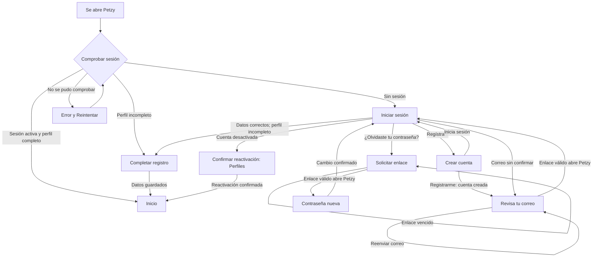

**Lectura sencilla:** la barra inferior aparece al entrar a Inicio, no en las pantallas de acceso. Abrir el enlace de confirmación muestra el resultado en Petzy y conduce a iniciar sesión; si después faltan nombre de usuario y estado, la persona completa esos dos datos antes de ver el contenido. Si la cuenta estaba desactivada, Petzy vuelve a comprobar correo y contraseña antes de reactivarla (D-41). El regreso exacto desde un enlace ya usado o inválido se detallará al revisar Cuenta; nunca abre contenido sin sesión válida.

### Publicaciones: recorrido propuesto para revisión

Este recorrido usa la [ficha de Publicaciones](ESPECIFICACIONES/02-PUBLICACIONES.md). «Inicio» es el feed de publicaciones generales; una publicación creada dentro de una comunidad permanece en esa comunidad. El botón para publicar se propone dentro de cada contexto, sin añadir una sexta opción a la barra inferior. Se propone un botón con texto «Crear publicación» encima de la lista, junto al área del filtro y sin tapar tarjetas. Las acciones del autor se agrupan en un menú de tres puntos dentro del detalle. Estas ubicaciones, las transiciones y el menú son propuestas para revisar; no se observan como funciones en la imagen de referencia ni están implementadas.

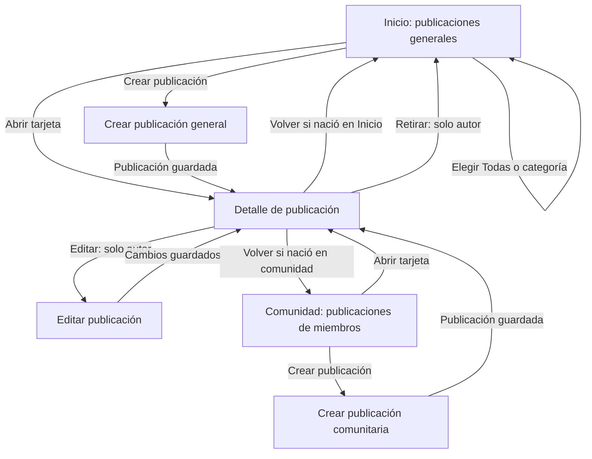

**Lectura sencilla:** el filtro de Inicio solo cambia la lista general. Desde una tarjeta se abre el detalle y se puede volver a la lista de origen. «Crear publicación» muestra el mismo formulario con el lugar de publicación visible: Inicio o la comunidad desde la que se abrió. El autor puede corregir o retirar su contenido desde el detalle; una retirada deja de verse y no se ofrece una restauración propia en esta versión. Los controles de comentarios y «Me gusta» pertenecen a [Interacciones](ESPECIFICACIONES/05-INTERACCIONES.md). Las acciones de moderación y la lista administrativa de retiradas se diseñarán con Comunidades.

### Perfiles: recorrido propuesto para revisión

La [ficha de Perfiles](ESPECIFICACIONES/03-PERFILES.md) distingue el perfil propio del ajeno: solo el dueño ve su correo y puede editar o desactivar su cuenta. «Buscar» es una de las cinco pestañas inferiores; «Mi perfil» se abre desde Ajustes. El acceso a Chat desde el perfil ajeno ya se acordó en D-124/D-75. Las pantallas y el acomodo propuestos aquí todavía no existen como flujo completo en la app.

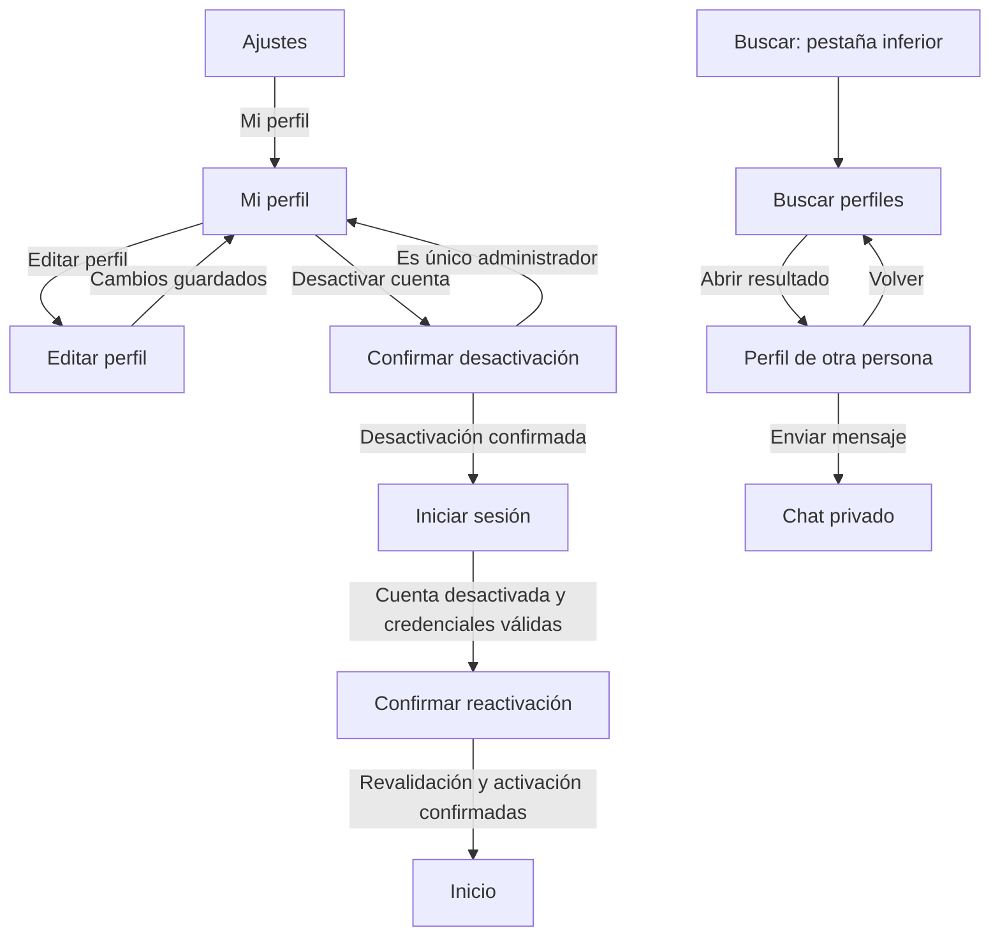

**Lectura sencilla:** Buscar solo muestra cuentas activas y abre el perfil público elegido. Ajustes lleva a «Mi perfil», donde el dueño puede corregir datos o iniciar la desactivación. Al desactivar, vuelve al ingreso; para reactivar debe entrar con el mismo correo y confirmar, con una nueva comprobación de correo y contraseña. Si es el único administrador de una comunidad, Petzy explica por qué no puede desactivarse todavía. Las fichas de mascotas y la conversación se abren con sus propios permisos; no se muestran correos ajenos.

### Mascotas: recorrido propuesto para revisión

La [ficha de Mascotas](ESPECIFICACIONES/04-MASCOTAS.md) permite registrar y consultar fichas sin exigir que toda persona tenga mascota. «Mis mascotas» se abre desde Ajustes y también se puede llegar a una ficha propia desde «Mi perfil». Una ficha ajena se abre desde el perfil público de su dueño o desde una publicación que la haya vinculado. El detalle muestra el mismo contenido básico a ambas personas, pero solo el dueño ve las acciones para corregir o desactivar.

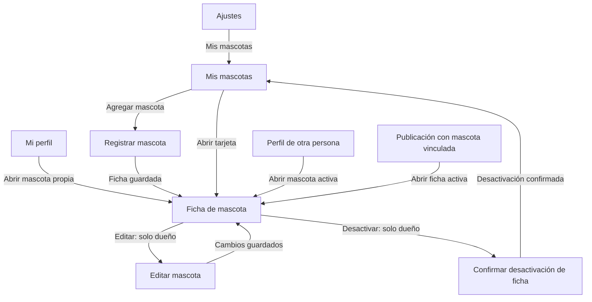

**Lectura sencilla:** quien tiene mascotas puede verlas y agregar otra desde su lista. Al crearla elige si sabe el día exacto de nacimiento o solo el mes y el año aproximados; no escribe la edad. La ficha muestra la edad calculada y, si corresponde, indica que es aproximada. Otra persona con cuenta puede leer una ficha activa, pero no ve sus controles de edición. Una ficha desactivada deja de aparecer y una publicación que la enlazaba sigue visible sin ese complemento; esta versión no define una restauración de fichas desactivadas.

### Interacciones: recorrido propuesto para revisión

La [ficha de Interacciones](ESPECIFICACIONES/05-INTERACCIONES.md) sitúa comentarios y «Me gusta» dentro del detalle de una publicación visible. Se propone un área de interacción en esa pantalla, no una pestaña inferior. El autor de un comentario puede editarlo o retirarlo; el autor del post puede ocultar comentarios ajenos según sea general o comunitario. El lugar de publicación determina quién puede recuperar esos comentarios.

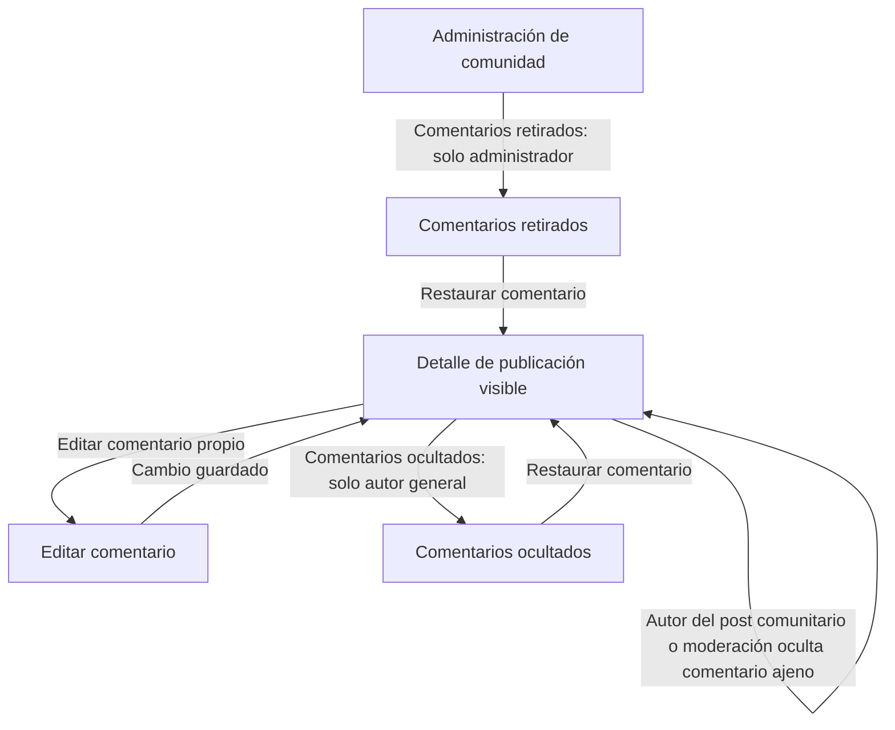

**Lectura sencilla:** cada comentario queda debajo de su publicación y el más reciente aparece primero. Al ocultar uno, desaparece del listado normal, pero se conserva. En Inicio, el autor del post recupera únicamente los comentarios ajenos que él ocultó, desde «Comentarios ocultados» de ese post. En comunidad, los comentarios ocultados por el autor del post, moderador o administrador se revisan y restauran solo desde la vista del administrador de esa comunidad. Un comentario que su propio autor retiró no entra en ninguna de esas vistas. Si se oculta la publicación o se pierde acceso a ella, tampoco se leen ni se cambian sus interacciones.

### Comunidades: recorrido propuesto para revisión

La [ficha de Comunidades](ESPECIFICACIONES/06-COMUNIDADES.md) separa la vista previa de la comunidad de sus publicaciones. Cualquier cuenta activa no expulsada puede encontrarla, ver sus datos básicos y consultar sus eventos; solo los miembros leen o crean publicaciones allí. El administrador tiene accesos propios para editar la comunidad, gestionar miembros y revisar retiradas. La ubicación visual de esos accesos es propuesta; los permisos y el contenido pertenecen a la ficha aprobada.

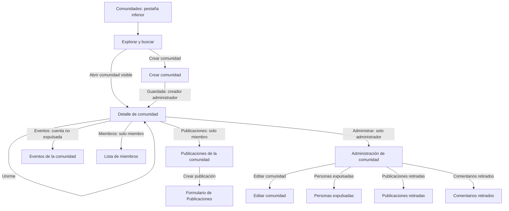

**Lectura sencilla:** la persona puede explorar aunque no tenga una mascota. Al entrar a una comunidad aún no unida ve nombre, descripción, foto si existe y cantidad de miembros; «Unirme» la incorpora de inmediato. Desde ese momento puede leer y crear publicaciones, ver miembros y salir. Al salir pierde acceso a los posts pero sus aportes activos permanecen; si vuelve, entra como Miembro. Una persona expulsada no ve la comunidad ni sus eventos hasta que el administrador retire el bloqueo, y entonces decide si quiere unirse. El último administrador activo no puede salir ni desactivar su cuenta hasta nombrar a otro. Los eventos se describen aparte.

### Chat privado: recorrido propuesto para revisión

La [ficha de Chat](ESPECIFICACIONES/07-CHAT-PRIVADO.md) define una conversación entre dos personas. El icono de mensajes de Inicio abre la bandeja; «Enviar mensaje» en un perfil ajeno y «Contactar» en un anuncio elegible abren la conversación con esa persona. Se reutiliza la misma conversación cuando ya existe. Los reportes se guardan en el MVP, pero su revisión por personal y las suspensiones pertenecen al sistema web futuro.

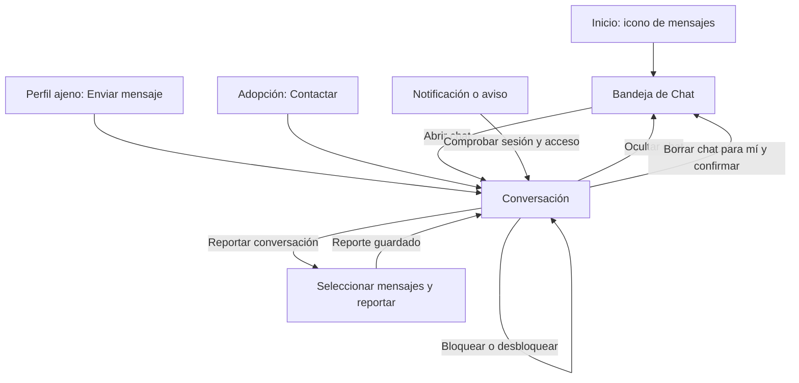

**Lectura sencilla:** ocultar saca la conversación de la bandeja propia hasta que llegue un mensaje nuevo, sin perder el historial. «Borrar chat para mí» deja de mostrar definitivamente los mensajes anteriores solo a quien lo pidió; la otra persona conserva su historial. Si existe un bloqueo, ambos aún pueden leer lo anterior pero ninguno envía mensajes nuevos. Un reporte selecciona mensajes concretos y se guarda; la app no promete que alguien lo haya revisado ni que haya suspendido una cuenta.

### Adopción: recorrido propuesto para revisión

La [ficha de Adopción](ESPECIFICACIONES/08-ADOPCION.md) define un apartado propio, separado de Publicaciones. Cada anuncio presenta un animal y entre una y tres fotos. «Contactar» reutiliza Chat solo en un anuncio ajeno que todavía dice «Busca hogar». El autor puede editar, cambiar el estado, retirar y recuperar su anuncio; una persona distinta puede reportar uno visible. Los reportes se guardan, pero aún no son revisados por el equipo.

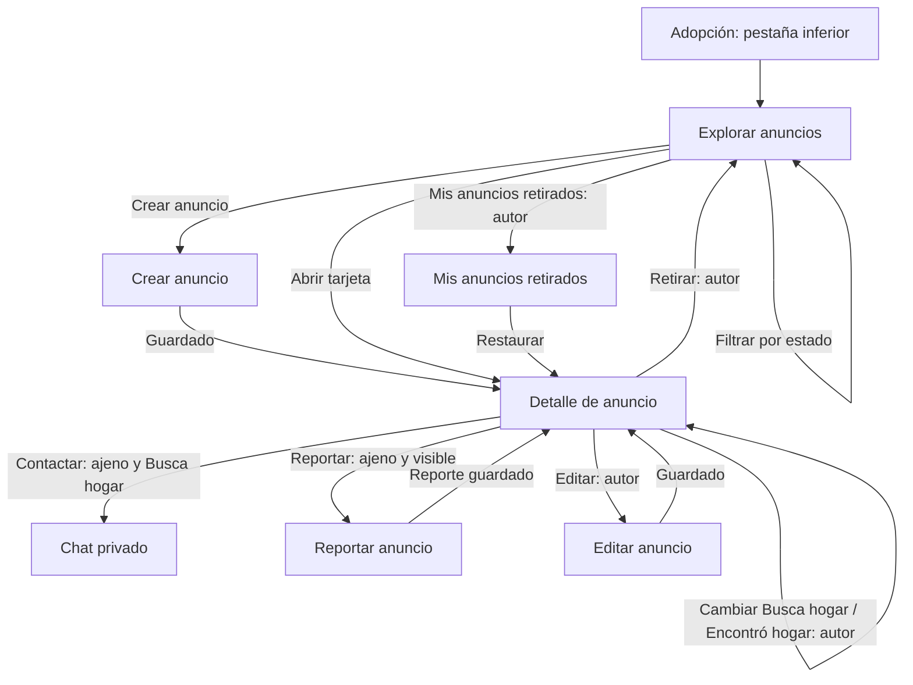

**Lectura sencilla:** la lista conjunta enseña primero animales que buscan hogar y, al final, los que ya lo encontraron; los filtros permiten ver solo uno de esos estados. Un anuncio «Encontró hogar» sigue visible, pero no ofrece «Contactar». Los anuncios retirados solo están en «Mis anuncios retirados» del autor y regresan con el estado que tenían al restaurarlos. No se muestran comentarios, «Me gusta», precio ni opciones de pago.

### Eventos: recorrido propuesto para revisión (etapa posterior al MVP)

La [ficha de Eventos](ESPECIFICACIONES/09-EVENTOS.md) sitúa cada encuentro dentro de una comunidad. Una cuenta activa no expulsada puede leerlo aun sin ser miembro; solo un miembro responde asistencia antes del inicio. Administradores y moderadores pueden crear. El creador, mientras siga en la comunidad, o un administrador vigente pueden editar o cancelar dentro de los plazos acordados. Esta navegación se documenta para la etapa posterior al MVP y no implica implementarla ahora.

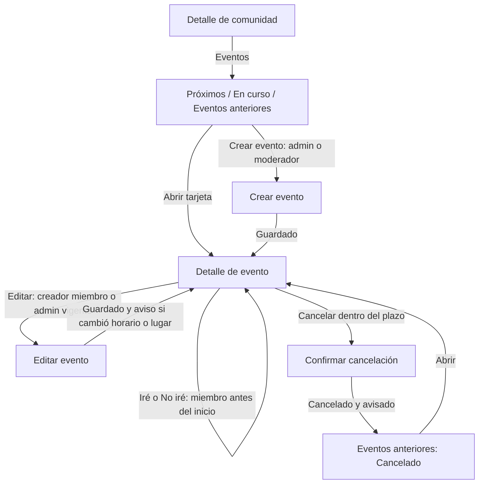

**Lectura sencilla:** «Próximos», «En curso» y «Eventos anteriores» pertenecen a la misma comunidad. Al comenzar, «Iré» y «No iré» dejan de aceptar cambios y se fija el total de confirmaciones; ese número no prueba que asistieran físicamente. Un evento cancelado pasa de inmediato a «Eventos anteriores», conserva su detalle y oculta el total. Si el lugar cambia, se muestra la nueva información y se avisa a quienes tenían «Iré» mediante Petzy y, si lo permitieron, el teléfono.

### Configuración: recorrido propuesto para revisión

La barra inferior acordada llama «Ajustes» a este destino y la pantalla se titula «Configuración» (D-124). Desde ella se abren «Mi perfil» y «Mis mascotas». D-126 añade la elección «Automático», «Claro» u «Oscuro» para toda Petzy. El cierre de sesión pertenece a Cuenta. No se añaden ajustes de notificaciones, privacidad u otras funciones que aún no estén definidos.

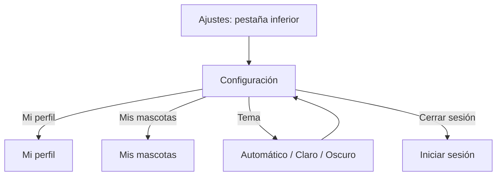

**Lectura sencilla:** al elegir «Automático», Petzy sigue el aspecto del teléfono; «Claro» u «Oscuro» aplican a toda la app hasta que se cambie la elección. «Cerrar sesión» quita el acceso local y lleva al ingreso. Esta pantalla no sustituye la confirmación de desactivación de la cuenta, que se abre desde «Mi perfil».

## 9. Diseño y descripción de pantallas de referencia y propuestas

### DI-REF-01 — Feed de referencia

**Objetivo aparente:** presentar publicaciones sobre mascotas y ofrecer filtros de categoría. **Estado:** imagen de referencia, no captura comprobada de una versión ejecutable de Petzy.

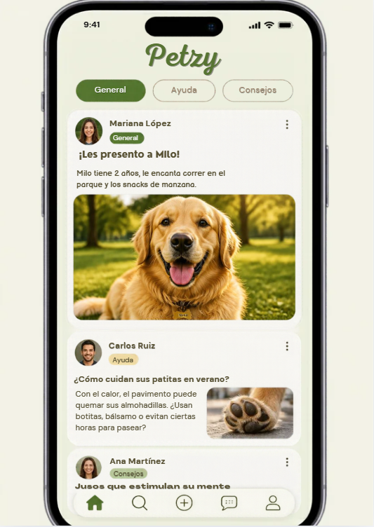

| Elemento | Descripción | Comportamiento |
| --- | --- | --- |
| Barra de estado | Hora «9:41» e iconos del teléfono, propios de la composición. | No pertenece a una función verificable de Petzy. |
| Logotipo «Petzy» | Texto verde, centrado, de estilo decorativo. | No se observa interacción. |
| Filtros «General», «Ayuda», «Consejos» | Tres opciones bajo el logotipo; «General» tiene fondo verde. | Solo se confirma el estado visual mostrado; cambio de filtro: Por definir. |
| Tarjeta de Mariana López | Foto circular, nombre, etiqueta «General», título «¡Les presento a Milo!», texto breve, foto grande de un perro y menú de tres puntos. | Lectura visual; apertura y acciones del menú: Por definir. |
| Tarjeta de Carlos Ruiz | Foto circular, nombre, etiqueta «Ayuda», título «¿Cómo cuidan sus patitas en verano?», texto, foto pequeña de una pata y menú de tres puntos. | Lectura visual; apertura y acciones del menú: Por definir. |
| Tarjeta parcial de Ana Martínez | Foto circular, nombre, etiqueta «Consejos», parte del título y menú de tres puntos. | El resto de la tarjeta no aparece en la captura; Por definir. |
| Barra inferior | Iconos de casa, lupa, «+», conversación y persona dentro de una superficie redondeada. | Casa resaltada; destinos, etiquetas y respuestas de los demás iconos: Por definir. |

### DI-OBJ-01 — Cambios acordados para el feed futuro

**Captura del diseño objetivo:** Por definir. Esta tabla describe decisiones posteriores del usuario y requisitos ya aprobados; no elementos presentes en la imagen anterior.

| Elemento | Descripción | Comportamiento |
| --- | --- | --- |
| Encabezado de Inicio | Mantiene la identidad visual de Petzy; no incluye «¡Hola, [nombre]!». | El acomodo exacto del logotipo y del icono de mensajes queda por diseñar. |
| Icono de mensajes | Acceso visible en la parte superior de Inicio. | Abre Chat con sesión válida; el aspecto de la bandeja queda en su módulo. |
| Filtro desplegable | Control encima del feed con la selección actual visible. | Ofrece «Todas» y las cinco categorías; al elegir una, cierra la lista y actualiza solo publicaciones generales. |
| Publicaciones | Conservan la idea visual de tarjetas con autor, categoría, texto y foto si existe. | El contenido y permisos siguen la ficha de Publicaciones; carga, vacío y error siguen los patrones acordados en la sección 10. |
| Barra inferior | Cinco destinos con icono y texto: «Inicio», «Comunidades», «Buscar», «Adopción» y «Ajustes». | Cambia de sección, indica la seleccionada y no se usa como botón de creación. |

### DI-CU-01 — Iniciar sesión (propuesta de Cuenta)

**Objetivo:** entrar con una cuenta confirmada. **Captura:** Por definir; la propuesta usa Nunito, el tema claro u oscuro acordado y un formulario sencillo sin barra inferior. El código actual reúne acceso y registro en una misma pantalla; D-133 pide separarlos en el diseño futuro.

| Elemento | Descripción | Comportamiento |
| --- | --- | --- |
| Logotipo «Petzy» y «Bienvenido de vuelta» | Identifican la app y la tarea de acceso. | No reemplazan las etiquetas de los campos. |
| Correo | Campo para el correo de la cuenta. | Señala formato inválido junto al campo y conserva el valor al fallar el ingreso. |
| Contraseña | Campo protegido con control para mostrar u ocultar el texto. | No se conserva indebidamente ni se muestra en mensajes de error. |
| «Iniciar sesión» | Acción principal. | Indica que está enviando, impide repetir la solicitud y abre Inicio solo con sesión válida y perfil completo. Un correo sin confirmar lleva a «Revisa tu correo»; un perfil incompleto, a «Completar registro». |
| «¿Olvidaste tu contraseña?» y «Regístrate» | Accesos secundarios visibles. | Abren «Solicitar enlace» y «Crear cuenta», respectivamente. |

### DI-CU-02 — Crear cuenta (propuesta de Cuenta)

**Objetivo:** registrar una identidad y los datos básicos de Petzy. **Captura:** Por definir. Es una pantalla independiente de «Iniciar sesión» (D-133); no pide registrar mascota.

| Elemento | Descripción | Comportamiento |
| --- | --- | --- |
| «Crea tu cuenta» | Encabezado breve. | Distingue el registro del ingreso. |
| Nombre de usuario y Correo | Campos obligatorios. | Muestran el error de formato o duplicado junto al campo correspondiente y conservan lo escrito al fallar. |
| Contraseña | Campo obligatorio protegido, con control para mostrar u ocultar. | Explica su validación sin publicar la contraseña ni conservarla indebidamente. |
| Estado | Selector del estado de residencia en México. | Muestra la elección actual y permite cambiarla antes de enviar. |
| «Registrarme» | Acción principal. | Indica envío y, si se crea la cuenta, abre «Revisa tu correo». Si se creó la identidad pero falló el perfil, la persona continuará con la misma cuenta después de confirmar el correo. |
| «Inicia sesión» | Acceso secundario. | Regresa a la pantalla separada de ingreso. |

### DI-CU-03 — Revisa tu correo (propuesta de Cuenta)

**Objetivo:** explicar por qué aún no puede entrar y cómo confirmar la cuenta. **Captura:** Por definir. El enlace recibido abre Petzy; esta pantalla no da acceso al contenido antes de confirmar.

| Elemento | Descripción | Comportamiento |
| --- | --- | --- |
| «Revisa tu correo» | Encabezado e instrucción breve para abrir el enlace de confirmación. | Si el enlace es válido, muestra el resultado y conduce a «Iniciar sesión». Si venció o ya se usó, explica qué pasó. |
| «Reenviar correo» | Acción para solicitar otro enlace. | Indica envío y resultado sin exponer si un correo ajeno tiene cuenta; evita envíos repetidos mientras procesa. |
| «Iniciar sesión» | Regreso al ingreso. | Abre la pantalla de acceso; sin confirmación no permite entrar al contenido. |

### DI-CU-04 — Completar registro (propuesta de Cuenta)

**Objetivo:** guardar los datos de Petzy cuando el correo y la contraseña ya pertenecen a una cuenta, pero faltó su perfil. **Captura:** Por definir. Un texto breve explicará que no hay que registrarse de nuevo.

| Elemento | Descripción | Comportamiento |
| --- | --- | --- |
| Nombre de usuario y Estado | Los dos datos que aún faltan; el correo procede de la cuenta confirmada. | Conservan lo escrito si el guardado falla. No se solicita otra contraseña ni una mascota. |
| «Completar registro» | Acción principal propuesta para guardar los datos. | Muestra «Guardando…» y abre Inicio solo después de confirmar el guardado. Un nombre ya ocupado se señala junto al campo. |
| Mensaje de error y «Reintentar» | Retroalimentación junto al formulario. | Permiten corregir o repetir sin crear una segunda cuenta. |

### DI-CU-05 — Solicitar enlace de recuperación (propuesta de Cuenta)

**Objetivo:** iniciar la recuperación de contraseña. **Captura:** Por definir.

| Elemento | Descripción | Comportamiento |
| --- | --- | --- |
| Correo | Campo para recibir el enlace de recuperación. | Conserva lo escrito ante un error de formato o envío. |
| «Enviar enlace» | Nombre propuesto para la acción principal. | Muestra progreso y después la misma confirmación tanto si el correo existe como si no; evita revelar cuentas ajenas. |
| «Iniciar sesión» | Regreso al ingreso. | Abre la pantalla de acceso sin dar por recuperada la contraseña. |

### DI-CU-06 — Contraseña nueva (propuesta de Cuenta)

**Objetivo:** terminar la recuperación desde un enlace válido que abre Petzy. **Captura:** Por definir.

| Elemento | Descripción | Comportamiento |
| --- | --- | --- |
| Contraseña nueva | Campo protegido con opción de mostrar u ocultar. | Señala la validación junto al campo sin exponer el valor. |
| «Guardar contraseña» | Nombre propuesto para la acción principal. | Muestra progreso y conduce a «Iniciar sesión» solo tras confirmar el cambio. |
| Enlace vencido y «Solicitar otro enlace» | Estado de recuperación cuando el enlace ya no sirve. | Vuelve a «Solicitar enlace de recuperación» sin mostrar el formulario de contraseña como si el enlace fuera válido. |

### DI-PU-01 — Inicio y feed general (propuesta de Publicaciones)

**Objetivo:** explorar publicaciones generales y llegar a la creación o al detalle. **Captura:** Por definir; toma de la referencia las tarjetas cálidas y fotos protagonistas, con la barra y el filtro acordados después. La posición exacta de «Crear publicación» es una propuesta, no algo visible en la imagen.

| Elemento | Descripción | Comportamiento |
| --- | --- | --- |
| Encabezado de Inicio | Identidad «Petzy» e icono de mensajes, sin saludo personalizado. | El icono abre Chat; el encabezado no desplaza la tarea principal de leer publicaciones. |
| Filtro desplegable | Control compacto alineado a la izquierda, con icono de filtros de tres líneas y «Filtrar por:» seguido de «Todas» o la categoría vigente. Ajuste solicitado e implementado el 25-10-2026. | Abre el menú animado compartido, con ancho propio limitado por las áreas seguras. Cambiar la opción reinicia la lista y muestra solo publicaciones generales de esa categoría; cancelar conserva la elección. |
| «Crear publicación» | Botón con ese texto implementado el 25-10-2026 encima de las tarjetas, junto al título Inicio y separado del control compacto de filtro. | Abre el formulario en contexto general sin tapar publicaciones. La fila admite salto con poco espacio o texto ampliado; su acomodo final en teléfonos pequeños queda por comprobar. |
| Tarjetas de publicación | Autor, fecha, categoría, título, texto y foto propia si existe; la ficha de mascota vinculada aparece como complemento si sigue activa. | Al tocar una tarjeta se abre el detalle. Una publicación sin foto no muestra un hueco vacío. Una de comunidad nunca aparece aquí. |
| Barra inferior | «Inicio», «Comunidades», «Buscar», «Adopción» y «Ajustes», con icono y etiqueta. | Señala Inicio como destino actual y permite cambiar de módulo. |
| Carga, vacío y error | Tarjetas de espera iniciales, mensaje si no hay resultados y «Reintentar» si falla la consulta. | Al cargar más se conserva lo ya visible; al cambiar de filtro no se presentan tarjetas de otra categoría como si fueran resultados nuevos. |

### DI-PU-02 — Detalle de publicación (propuesta de Publicaciones)

**Ajuste implementado el 25-10-2026:** la flecha y «Volver» permanecen en una cabecera propia, dentro del área segura y fuera del `ScrollView`. Solo se desplazan la publicación y sus comentarios; se puede regresar desde cualquier posición, también durante carga o error. La cabecera no muestra nombres de ruta internos y conserva el regreso seguro cuando falta historial. TypeScript y lint dirigido pasan; comprobar desplazamiento largo y texto ampliado en iPhone sigue pendiente.

**Objetivo:** leer completa una publicación que la persona tiene permiso de ver. **Captura:** Por definir. La misma estructura sirve para una publicación general o comunitaria; el regreso conserva el lugar desde el que se abrió.

| Elemento | Descripción | Comportamiento |
| --- | --- | --- |
| Regresar y contexto | Control para volver e indicación de Inicio o de la comunidad correspondiente. | Regresa a la lista de origen. La categoría no cambia el lugar de publicación. |
| Autor y fecha | Nombre público, foto de perfil si existe y fecha de la publicación. | El acceso al perfil usa las reglas de Perfiles; no muestra correo. |
| Categoría, título y descripción | Contenido principal, con jerarquía clara y texto legible. | Muestra la categoría elegida por el autor, sin tratar «Todas» como categoría. |
| Foto de publicación | Una foto como máximo, si el autor añadió una. | Si existe pero falla su carga, se indica que no pudo mostrarse; si nunca se añadió, no aparece un espacio vacío. |
| Mascota vinculada | Bloque adicional con nombre, foto disponible y acceso a su ficha activa. | No reemplaza la foto del post. Si la ficha se desactiva, este bloque desaparece y la publicación permanece. |
| «Me gusta» y comentarios | Área de interacción debajo del contenido. | Sus permisos, orden y acciones siguen la ficha de Interacciones; el diseño detallado se revisará en ese módulo. |
| Acciones del autor | Menú de tres puntos propuesto con «Editar publicación» y «Retirar publicación». | Solo se ofrece al autor. Antes de retirar, un aviso propuesto explica que dejará de verse; la retirada se confirma cuando responde el servidor. |
| Acceso perdido o publicación retirada | Mensaje claro en lugar de contenido cuando el enlace ya no se puede abrir. | No revela una publicación comunitaria a quien dejó de ser miembro ni una publicación oculta; ofrece volver a la lista disponible. |

### DI-PU-03 — Crear publicación (propuesta de Publicaciones)

**Objetivo:** compartir texto y, opcionalmente, una foto y una ficha de mascota. **Captura:** Por definir. El formulario indica si se publicará en Inicio o en una comunidad; ese contexto procede de la pantalla que lo abrió y no se cambia dentro del formulario.

| Elemento | Descripción | Comportamiento |
| --- | --- | --- |
| Lugar de publicación | Texto visible «Inicio» o nombre de la comunidad de origen. | Una publicación comunitaria exige membresía; no se mueve de lugar mediante la categoría. |
| Título | Campo obligatorio de hasta 120 caracteres. | Señala vacío o exceso junto al campo sin borrar lo escrito. |
| Descripción | Campo obligatorio de hasta 3 000 caracteres. | Permite escribir con teclado visible y conservar el contenido ante un error. |
| Categoría | Selector obligatorio de General, Ayuda, Consejo, Pregunta o Mascota perdida. | La selección se muestra antes de publicar; no se asigna General sin que la persona lo elija. |
| «Añadir foto» | Control opcional para una imagen JPEG, PNG o WebP de hasta 5 MB. | Muestra la imagen elegida y permite quitarla antes de publicar. Si el archivo no cumple la regla, explica el motivo y mantiene el texto. |
| «Vincular mascota» | Selección opcional entre las fichas propias activas. | Permite no elegir ninguna o quitar la elegida; la foto de la ficha no ocupa el lugar de la foto del post. |
| «Publicar» | Acción principal propuesta para guardar. | Muestra «Publicando…», evita envíos duplicados y abre el detalle solo cuando se confirma el guardado. Si falla, mantiene título, descripción, categoría, foto y mascota seleccionadas para corregir o reintentar. |
| Regresar | Vuelve a la lista de origen. | Si ya se escribió algo, se propone preguntar «¿Salir sin publicar?» con «Seguir editando» y «Salir sin guardar». No se presupone guardado automático. |

### DI-PU-04 — Editar publicación (propuesta de Publicaciones)

**Objetivo:** corregir una publicación propia sin cambiar su autor ni su lugar. **Captura:** Por definir. Reutiliza el orden de campos de «Crear publicación» y muestra los valores actuales.

| Elemento | Descripción | Comportamiento |
| --- | --- | --- |
| Lugar de publicación | Indicación de Inicio o de la comunidad donde se creó. | Solo lectura: no permite trasladar la publicación. |
| Título, descripción y categoría | Campos con el contenido guardado, sujetos a las mismas reglas de creación. | La categoría nueva cambia los resultados del filtro correspondiente después de guardar; no cambia el contexto general o comunitario. |
| Foto | Foto actual o control para añadir una; máximo una. | Permite conservar, reemplazar o quitar la foto propia de la publicación. |
| Mascota vinculada | Ficha activa propia elegida, si existe. | Permite conservar, cambiar o quitar el vínculo; no acepta fichas ajenas o inactivas. |
| «Guardar cambios» | Acción principal propuesta. | Muestra «Guardando…» y vuelve al detalle al confirmar. Si falla, conserva los cambios escritos y la selección para reintentar. |
| Regresar | Vuelve al detalle. | Si se cambió algún dato, se propone preguntar «¿Salir sin guardar?» con «Seguir editando» y «Salir sin guardar». Salir nunca se presenta como guardado exitoso. |

**Estado de estas cuatro pantallas:** el usuario revisó y aceptó el recorrido de Publicaciones y las propuestas de botón con texto encima de la lista, menú de tres puntos para acciones del autor y avisos al retirar o salir con cambios sin guardar el 18 de octubre de 2026. Son diseño futuro, no capturas de la app actual. La lista administrativa de publicaciones retiradas se describirá en Comunidades; comentarios y «Me gusta» se detallarán en Interacciones.

### DI-PE-01 — Buscar perfiles (propuesta de Perfiles)

**Objetivo:** encontrar a una persona por su nombre de usuario. **Captura:** Por definir. Esta es la pantalla principal de la pestaña «Buscar»; usa las superficies, tipografía y espaciado acordados para Petzy.

| Elemento | Descripción | Comportamiento |
| --- | --- | --- |
| Título «Buscar perfiles» | Identifica claramente el contenido de la pestaña. | La barra inferior señala «Buscar» como destino actual. |
| Búsqueda por nombre de usuario | Campo con etiqueta visible para escribir de 2 a 50 caracteres. | Antes de dos caracteres explica el mínimo; no muestra resultados ajenos a lo escrito. Conserva la búsqueda si la consulta falla. |
| Lista de resultados | Tarjetas sencillas con foto o icono de respaldo, nombre de usuario, biografía si existe y estado de México. | Cada tarjeta abre el perfil público. No muestra correo ni cuentas desactivadas. Carga 20 resultados por página y permite continuar sin duplicarlos. |
| Vacío, carga y error | Mensajes junto a la lista: instrucción antes de buscar, ausencia de coincidencias o fallo de consulta. | La carga muestra una señal discreta; el fallo ofrece «Reintentar» sin borrar la búsqueda. |

### DI-PE-02 — Perfil de otra persona (propuesta de Perfiles)

**Objetivo:** reconocer a otra persona, ver sus datos públicos y acceder a sus mascotas activas o a Chat. **Captura:** Por definir. La foto tiene presencia visual sin desplazar el nombre ni las acciones legibles.

| Elemento | Descripción | Comportamiento |
| --- | --- | --- |
| Regresar y «Perfil» | Control de retorno y encabezado sencillo. | Vuelve a Buscar o a la pantalla desde la que se abrió el perfil. |
| Foto de perfil y nombre de usuario | Identidad pública de la persona; icono neutro si no añadió foto. | La foto privada se entrega solo a una cuenta activa autorizada; una falla de carga se distingue de la ausencia de foto. |
| Biografía y estado de México | Texto público y ubicación por estado. | Si no hay biografía, no se inventa contenido. El correo y las credenciales nunca aparecen. |
| «Enviar mensaje» | Acción de contacto ya acordada para perfiles ajenos. | Abre el Chat privado con esa persona. Si hay un bloqueo entre ambas, Chat explicará que no se pueden enviar mensajes. |
| Mascotas activas | Tarjetas de mascotas propias de esa persona, si las tiene. | Cada tarjeta abre su ficha según Mascotas; si no tiene ninguna, el perfil sigue siendo válido y muestra un vacío amable. |
| Perfil no disponible y error | Estado si la cuenta dejó de estar activa o no se encuentra; fallo de lectura por separado. | No entrega datos privados por enlace directo; el fallo de consulta ofrece «Reintentar». |

### DI-PE-03 — Mi perfil (propuesta de Perfiles)

**Objetivo:** revisar los datos propios y encontrar las acciones para corregirlos o desactivar la cuenta. **Captura:** Por definir. Se abre desde «Configuración» en la pestaña «Ajustes»; no añade una pestaña inferior nueva.

| Elemento | Descripción | Comportamiento |
| --- | --- | --- |
| «Mi perfil» y regresar | Encabezado y retorno a Configuración. | Mantiene claro que se está viendo la cuenta propia. |
| Foto, nombre, biografía y estado | Datos del perfil con el mismo tratamiento visual que el perfil ajeno. | Se muestran los cambios confirmados; una foto ausente usa icono de respaldo. |
| Correo | Dato privado propio, separado de los datos públicos. | Solo aparece aquí para el dueño y es de solo lectura en esta versión. |
| «Editar perfil» | Acción principal propuesta para modificar datos permitidos. | Abre el formulario de edición sin permitir cambiar correo ni contraseña desde él. |
| Mascotas activas | Lista breve de sus fichas, si existen. | Abre la ficha correspondiente; si no hay mascotas, no bloquea el uso del perfil. «Mis mascotas» conserva su acceso desde Ajustes. |
| «Desactivar cuenta» | Acción secundaria visible pero separada de «Editar perfil». | Abre una explicación y confirmación; no desactiva al primer toque. |
| Carga y error | Espera local para datos propios y mensaje de fallo. | Ofrece «Reintentar»; no presenta campos incompletos como si el perfil estuviera vacío. |

### DI-PE-04 — Editar perfil (propuesta de Perfiles)

**Objetivo:** cambiar solo los datos permitidos del perfil propio. **Captura:** Por definir. El formulario usa Nunito, etiquetas junto a cada campo y controles alcanzables con el teclado abierto.

| Elemento | Descripción | Comportamiento |
| --- | --- | --- |
| Nombre de usuario | Campo obligatorio de 3 a 30 caracteres. | Señala nombre ocupado, longitud o ausencia de texto junto al campo; conserva lo escrito si falla el guardado. |
| Biografía | Campo opcional de hasta 300 caracteres. | Puede quedar vacía o quitarse sin inventar un texto de sustitución. |
| Estado | Selector del estado de residencia en México. | Muestra la elección actual y permite corregirla. |
| Foto de perfil | Imagen actual o icono de respaldo, con acciones propuestas para añadir, cambiar o quitar. | Acepta JPEG, PNG o WebP de hasta 5 MB; explica un archivo inválido y conserva los demás datos. |
| «Guardar cambios» | Acción principal propuesta. | Muestra «Guardando…», impide envíos repetidos y vuelve a «Mi perfil» solo tras confirmar los cambios. |
| Regresar | Vuelve a «Mi perfil». | Si hubo cambios, se propone el mismo aviso «¿Salir sin guardar?» de Publicaciones; no se anuncia éxito si no se guardó. |

### DI-PE-05 — Confirmar desactivación (propuesta de Perfiles)

**Objetivo:** explicar el efecto de desactivar la cuenta antes de tomar la decisión. **Captura:** Por definir. Se propone una vista de confirmación con texto breve y acciones bien diferenciadas.

| Elemento | Descripción | Comportamiento |
| --- | --- | --- |
| Explicación | Indica que perfil, mascotas, publicaciones y comentarios dejarán de verse, y que los datos se conservarán para una futura reactivación. | No presenta la acción como borrado definitivo; aclara que los «Me gusta» dejarán de contarse y que la persona saldrá de la app. |
| «Conservar mi cuenta» | Acción para cancelar. | Regresa a «Mi perfil» sin cambios. |
| «Desactivar cuenta» | Confirmación explícita. | Muestra progreso y vuelve a «Iniciar sesión» solo si el servidor confirma la desactivación. |
| Único administrador | Mensaje si la persona dejaría una comunidad sin otro administrador activo. | Explica que debe nombrar a otro antes; conserva la cuenta activa y ofrece volver. No presupone una reasignación automática. |
| Error de solicitud | Mensaje en esta vista cuando no se pudo completar la acción. | Permite «Reintentar» sin mostrar la cuenta como desactivada antes de tiempo. |

### DI-PE-06 — Confirmar reactivación (propuesta de Perfiles)

**Objetivo:** permitir que el dueño recupere una cuenta que desactivó voluntariamente. **Captura:** Por definir. Aparece después de ingresar con el mismo correo; pertenece al recorrido de Cuenta aunque la regla de reactivación esté definida en Perfiles.

| Elemento | Descripción | Comportamiento |
| --- | --- | --- |
| Explicación | Informa que la cuenta está desactivada y que se conservaron sus datos y roles. | Aclara que el contenido retirado individualmente seguirá oculto. |
| «Reactivar cuenta» | Acción principal tras la confirmación de la persona. | El servidor vuelve a comprobar correo y contraseña; solo después de confirmar abre Inicio. La app conserva esas credenciales solo en memoria durante este paso. |
| «Volver a iniciar sesión» | Salida de la confirmación. | Regresa al ingreso; si la app se cerró, la persona vuelve a escribir sus credenciales. |
| Error de credenciales o solicitud | Mensaje junto a la acción. | No activa la cuenta ni abre contenido; explica el error sin exponer datos internos y permite corregir o reintentar. |

**Estado de Perfiles:** el usuario revisó y aceptó estas seis pantallas y su diagrama el 18 de octubre de 2026, incluida la organización de «Mi perfil», el acceso «Enviar mensaje» y la confirmación de desactivación. Son diseños futuros, no capturas de la versión actual. La apariencia de fichas de mascota y de Chat se define con sus módulos.

### DI-MA-01 — Mis mascotas (propuesta de Mascotas)

**Objetivo:** reconocer las fichas propias activas y registrar otra mascota. **Captura:** Por definir. Se abre desde «Configuración» en la pestaña «Ajustes»; no requiere una pestaña inferior adicional.

| Elemento | Descripción | Comportamiento |
| --- | --- | --- |
| «Mis mascotas» y regresar | Título de la vista y retorno a Configuración. | Mantiene claro que la lista pertenece a la cuenta propia. |
| «Agregar mascota» | Acción con texto visible cerca del inicio de la lista. | Abre el formulario para registrar una ficha. También aparece en el estado vacío. |
| Tarjetas de mascotas | Foto o icono de respaldo, nombre, especie, raza y edad calculada. | Cada tarjeta abre la ficha. Si el nacimiento es aproximado, la edad lleva esa indicación; no se muestra una edad guardada manualmente. |
| Vacío, carga y error | Mensaje «Aún no has agregado mascotas» como texto propuesto, espera discreta y fallo de consulta. | El vacío conserva «Agregar mascota»; el error ofrece «Reintentar» y no se confunde con una lista realmente vacía. |

### DI-MA-02 — Registrar mascota (propuesta de Mascotas)

**Objetivo:** guardar una ficha con los datos de identificación y nacimiento. **Captura:** Por definir. Se propone agrupar primero nombre, especie y raza; después el modo de nacimiento; al final, descripción y foto opcionales.

| Elemento | Descripción | Comportamiento |
| --- | --- | --- |
| Nombre | Campo obligatorio de 2 a 50 caracteres. | Señala la ausencia de texto o un exceso junto al campo sin borrar el resto. |
| Especie | Selector con Perro, Gato, Ave, Conejo y «Otra». | «Otra» abre un campo obligatorio de 2 a 50 caracteres para escribir la especie. |
| Raza | Campo obligatorio de 2 a 50 caracteres. | Permite responder «Mestiza» o «Raza desconocida» cuando no se conoce una raza concreta. |
| Nacimiento | Elección propuesta entre «Fecha exacta» y «Mes y año aproximados». | En el primer caso pide día, mes y año válidos; en el segundo solo mes y año. Rechaza fechas futuras y nunca inventa un día. |
| Edad | No hay campo de edad en el formulario. | Petzy la calcula al consultar la ficha; no la solicita ni la guarda como años escritos por la persona. |
| Descripción | Campo opcional de hasta 300 caracteres. | Puede dejarse vacío; un texto demasiado largo se señala sin perder lo demás. |
| «Añadir foto» | Una imagen opcional con vista previa o icono de respaldo. | Acepta JPEG, PNG o WebP de hasta 5 MB; si falla la carga o el archivo no sirve, explica por qué y conserva los otros datos. |
| «Guardar mascota» | Acción principal propuesta. | Muestra «Guardando…», evita envíos duplicados y abre la ficha solo tras confirmar que se guardó. Si falla, conserva el formulario para corregir o reintentar. |
| Regresar | Vuelve a «Mis mascotas». | Si hay datos escritos, se propone preguntar «¿Salir sin guardar?» con «Seguir editando» y «Salir sin guardar», como en los formularios ya revisados. |

### DI-MA-03 — Ficha de mascota (propuesta de Mascotas)

**Objetivo:** consultar los datos actuales de una mascota. **Captura:** Por definir. La imagen, si existe, destaca sin tapar nombre, nacimiento ni edad; una mascota sin foto usa el icono neutro acordado.

| Elemento | Descripción | Comportamiento |
| --- | --- | --- |
| Regresar y nombre | Identifica la ficha y permite volver a la pantalla de origen. | Conserva el retorno a «Mis mascotas», al perfil o a la publicación desde la que se abrió. |
| Foto o icono | Imagen opcional de la mascota. | Solo se entrega a cuentas activas mientras mascota y dueño sigan activos; un fallo de carga se distingue de la ausencia de foto. |
| Especie, raza y descripción | Datos de la ficha, con descripción solo si se añadió. | No sustituye raza o descripción por contenido inventado. |
| Nacimiento y edad | Fecha exacta y edad calculada, o «Nacimiento aproximado: mes de año» y «Edad aproximada: N años». | Muestra la fecha exacta también a otra cuenta si se conoce; si no hay día, nunca presenta uno supuesto. La edad cambia al volver a consultar, sin edición del dueño. |
| «Editar mascota» y «Desactivar ficha» | Acciones propuestas para el dueño en un menú de tres puntos. | No se muestran a otras personas. «Desactivar ficha» abre una confirmación antes de ocultarla. |
| Ficha no disponible y error | Mensaje si se desactivó la ficha o la cuenta del dueño; fallo de consulta por separado. | No entrega datos por enlace directo cuando no hay permiso; una falla temporal ofrece «Reintentar». |

### DI-MA-04 — Editar mascota (propuesta de Mascotas)

**Objetivo:** corregir los datos de una ficha propia activa. **Captura:** Por definir. Conserva el orden y las reglas del formulario de registro, con los valores actuales visibles.

| Elemento | Descripción | Comportamiento |
| --- | --- | --- |
| Nombre, especie y raza | Campos actuales, con la misma validación de «Registrar mascota». | Permite corregirlos; «Otra» especie conserva el campo de texto correspondiente. |
| Nacimiento | Fecha exacta o mes y año aproximados, según lo guardado. | El dueño puede corregir los datos de nacimiento; el resultado recalcula la edad al volver a consultar. No se edita un campo de edad. |
| Descripción | Texto opcional actual. | Puede actualizarse o quitarse; máximo 300 caracteres. |
| Foto | Imagen actual o icono de respaldo. | Permite añadir, reemplazar o quitar la foto; acepta los mismos formatos y 5 MB. |
| «Guardar cambios» | Acción principal propuesta. | Indica «Guardando…» y vuelve a la ficha cuando se confirma. Si falla, mantiene datos y selección de foto para reintentar. |
| Regresar | Vuelve a la ficha. | Con cambios sin guardar se propone el aviso «¿Salir sin guardar?»; salir no se confunde con guardar. |

### DI-MA-05 — Confirmar desactivación de ficha (propuesta de Mascotas)

**Objetivo:** evitar retirar una ficha propia por error. **Captura:** Por definir. Se propone una confirmación breve desde el detalle, sin llamarla eliminación definitiva.

| Elemento | Descripción | Comportamiento |
| --- | --- | --- |
| Explicación | Indica que la mascota dejará de verse en «Mis mascotas», perfiles y enlaces de publicaciones. | Aclara que las publicaciones anteriores permanecen, pero dejan de mostrar o enlazar esta ficha. |
| «Conservar ficha» | Acción para cancelar. | Regresa al detalle sin cambiar la mascota. |
| «Desactivar ficha» | Confirmación explícita. | Muestra el progreso y vuelve a «Mis mascotas» solo cuando el servidor confirma la retirada. |
| Error | Mensaje en la misma confirmación si la operación falla. | La ficha sigue visible y puede intentarse de nuevo sin anunciar éxito falso. |

**Estado de Mascotas:** el usuario revisó y aceptó estas cinco pantallas y su diagrama el 18 de octubre de 2026, incluida la elección entre fecha exacta y aproximada, el menú del dueño y la confirmación para desactivar una ficha. Son diseños futuros; no existe un prototipo navegable ni se modificó el código.

### DI-IN-01 — Comentarios y «Me gusta» en el detalle (propuesta de Interacciones)

**Objetivo:** conversar y reaccionar a una publicación que la persona puede ver. **Captura:** Por definir. Esta área se incorpora debajo del contenido de DI-PU-02 y usa la misma tarjeta, colores y jerarquía visual, sin introducir otra pantalla de publicación.

| Elemento | Descripción | Comportamiento |
| --- | --- | --- |
| «Me gusta» y total | Control con texto e icono comprensible, selección visible y número de reacciones. | Da o quita una reacción propia; durante el envío muestra progreso local y evita toques duplicados. Si falla, vuelve al estado confirmado y explica el error sin alterar el total como si se hubiera guardado. |
| «Comentarios» | Encabezado de la sección debajo de la publicación. | Muestra comentarios activos del más reciente al más antiguo, 20 por página y máximo 30 por solicitud. |
| Cada comentario | Foto del autor o icono de respaldo, nombre público, fecha y texto; «Editado» cuando el texto se corrigió. | No muestra correo, imágenes adjuntas ni respuestas anidadas. «Editado» no aparece solo por retirar o restaurar. |
| Campo de comentario y «Comentar» | Entrada de texto obligatoria de hasta 500 caracteres y acción de envío. | Indica vacío o exceso junto al campo. Al enviar muestra «Publicando…», bloquea solo el envío repetido y conserva el texto si falla. Tras confirmarse, el comentario aparece una sola vez. |
| «Cargar más» | Acción al final de la lista cuando quedan comentarios. | Mantiene los ya visibles; un fallo aparece al final con «Reintentar» sin reiniciar toda la sección. |
| Vacío y error | Mensaje cuando aún no hay comentarios, o fallo de lectura distinto. | Un vacío real invita a comentar; un fallo ofrece «Reintentar» y no aparenta ausencia de comentarios. |
| Publicación no visible | Estado del detalle cuando la publicación se retiró o la persona perdió membresía. | No se muestran comentarios ni total de «Me gusta» y no se aceptan nuevas acciones, incluso si se abre por enlace directo. |

### DI-IN-02 — Acciones y edición de comentario (propuesta de Interacciones)

**Objetivo:** permitir correcciones propias y retiradas autorizadas sin confundir sus permisos. **Captura:** Por definir. Se propone un menú de tres puntos junto a cada comentario, con opciones distintas según quién lo abre; «Editar comentario» usa un campo en el mismo detalle.

| Elemento | Descripción | Comportamiento |
| --- | --- | --- |
| Menú del comentario propio | «Editar comentario» y «Retirar mi comentario». | Su autor puede corregirlo en cualquier momento mientras comentario y publicación sigan activos y conserve acceso. Retirarlo lo oculta; no aparece en vistas ajenas de restauración. |
| «Editar comentario» | Campo de texto con el contenido actual, en el lugar del comentario. | Exige texto con contenido de hasta 500 caracteres. «Guardar cambios» muestra progreso; si falla, conserva la edición. Al confirmarse, se muestra «Editado». «Cancelar» vuelve al texto guardado. |
| Menú de comentario ajeno en post general | «Ocultar comentario», solo para el autor de ese post. | Tras confirmar, lo retira del listado normal y lo deja disponible en «Comentarios ocultados» de ese mismo post. Otros lectores no ven la opción. |
| Menú de comentario ajeno en comunidad | «Ocultar comentario» para el autor del post, administrador o moderador de esa comunidad. | Tras confirmar, lo retira del listado normal; solo el administrador lo verá en «Comentarios retirados» y podrá restaurarlo. |
| Confirmación y error | Mensaje breve antes de ocultar o retirar y resultado junto al comentario. | No se declara éxito hasta recibir respuesta. Si falla, el comentario permanece visible y se explica cómo reintentar. |

### DI-IN-03 — Comentarios ocultados de un post general (propuesta de Interacciones)

**Objetivo:** permitir al autor de una publicación de Inicio recuperar un comentario ajeno que ocultó por error. **Captura:** Por definir. Se abre desde el detalle de esa publicación y solo lo ve su autor.

| Elemento | Descripción | Comportamiento |
| --- | --- | --- |
| «Comentarios ocultados» y regresar | Título y retorno al detalle del post general. | No aparece en publicaciones comunitarias ni a otros lectores. |
| Lista de comentarios | Texto, autor y fecha de cada comentario ajeno que el autor del post ocultó allí. | No incluye comentarios retirados por sus propios autores ni los de otra publicación; conserva su fecha original. |
| «Restaurar comentario» | Acción individual junto a cada elemento. | Muestra progreso y, si el servidor confirma, devuelve el comentario al detalle según su fecha, sin duplicarlo. |
| Vacío y error | Indica que no hay comentarios ocultados por el autor o que falló la consulta. | Un error ofrece «Reintentar»; la lista no muestra contenido ajeno aunque se conozca un ID. |

### DI-IN-04 — Comentarios retirados de la comunidad (propuesta de Interacciones)

**Objetivo:** que el administrador de una comunidad revise y restaure retiradas autorizadas. **Captura:** Por definir. Se propone como vista de administración de esa comunidad; su navegación global se completará al diseñar Comunidades.

| Elemento | Descripción | Comportamiento |
| --- | --- | --- |
| «Comentarios retirados» y contexto | Título, nombre de comunidad y acceso a la publicación de origen cuando sea visible. | Solo el administrador activo de esa comunidad entra; ni moderadores ni autores de posts sin rol de administrador ven esta vista. |
| Lista de retiradas | Comentarios ajenos ocultados por un administrador, moderador o autor de post comunitario. | No incluye comentarios retirados por su propio autor ni contenido de otras comunidades. |
| «Restaurar comentario» | Acción individual para el administrador. | Muestra progreso; tras confirmación, el comentario vuelve a su publicación si esta sigue activa y sus permisos lo permiten. |
| Vacío, acceso denegado y error | Estados distintos para lista sin elementos, rol insuficiente o fallo de consulta. | Un fallo ofrece «Reintentar»; una persona sin permiso no recibe el contenido por enlace directo. |

**Estado de Interacciones:** el usuario revisó y aceptó estas cuatro vistas y el recorrido el 18 de octubre de 2026, siempre que respeten la ficha funcional ya aprobada. Mantienen comentarios y likes dentro del detalle, edición del comentario propio, «Comentarios ocultados» en Inicio y restauración comunitaria solo por el administrador. Todavía no están implementadas como flujo completo.

### DI-CO-01 — Explorar comunidades (propuesta de Comunidades)

**Objetivo:** encontrar una comunidad por interés o crear una nueva. **Captura:** Por definir. Es el destino de la pestaña inferior «Comunidades»; las fotografías o sus iconos de respaldo ayudan a reconocer cada grupo.

| Elemento | Descripción | Comportamiento |
| --- | --- | --- |
| «Comunidades» y «Crear comunidad» | Título y acción visible dentro de la sección. | Abre el formulario de creación; no exige que la persona haya registrado una mascota. |
| Buscar comunidades | Campo para buscar por nombre o tema, de 2 a 50 caracteres. | Indica el mínimo y máximo; carga 20 resultados por página, como máximo 30 por solicitud, sin borrar el texto si falla. |
| Tarjetas de comunidades | Nombre, descripción, foto disponible o icono de respaldo y cantidad de miembros activos. | Abren la vista previa o el detalle según la membresía. Nombres iguales pueden aparecer como resultados distintos. |
| Carga, vacío y error | Señal de espera discreta, estado sin resultados y fallo de consulta. | Diferencia «No encontramos comunidades» de un error; ofrece «Reintentar» sin perder la búsqueda. Una comunidad que expulsó a esta cuenta no aparece. |

### DI-CO-02 — Detalle de comunidad (propuesta de Comunidades)

**Objetivo:** comprender una comunidad y acceder a su contenido permitido. **Captura:** Por definir. Se propone encabezado con foto o icono, nombre, descripción y cantidad de miembros; el tema sirve para buscar, pero no se añade a esta vista previa porque D-61 fijó sus datos visibles.

| Elemento | Descripción | Comportamiento |
| --- | --- | --- |
| Encabezado y estado de membresía | Nombre, descripción, foto opcional y número de miembros activos; para quien pertenece, su rol Miembro, Moderador o Administrador. | Si una cuenta fue expulsada, no recibe esta vista ni la foto, aunque abra un enlace directo. |
| «Unirme» | Acción para una cuenta activa no miembro ni expulsada. | La entrada es inmediata y la interfaz pasa al estado de miembro solo tras confirmación. Un doble toque no crea otra membresía. |
| «Publicaciones» y «Eventos» | Secciones separadas dentro de la misma comunidad. | «Publicaciones» exige membresía; «Eventos» puede consultarse sin ser miembro si la cuenta no está expulsada. El contenido y estados de carga se resuelven por sección. |
| «Miembros» | Acceso a la lista de integrantes, visible a miembros. | No aparece a no miembros. La lista no muestra correos. |
| «Administrar» | Acceso propuesto para administrador, separado del contenido ordinario. | Abre edición, roles, expulsiones y retiradas de esta comunidad; no aparece a moderadores ni miembros. |
| «Salir de la comunidad» | Acción para un miembro. | Pide confirmación y deja de mostrar posts al completarse. Si es el último administrador activo, explica que debe nombrar otro antes y conserva su membresía. |
| Acceso perdido y error | Estado si la cuenta ya no pertenece o la comunidad no está disponible; fallo temporal por separado. | No deja visibles publicaciones previas sin permiso; un fallo de carga ofrece «Reintentar». |

### DI-CO-03 — Crear y editar comunidad (propuesta de Comunidades)

**Objetivo:** crear un grupo o, siendo administrador, corregir sus datos. **Captura:** Por definir. Se propone un formulario compartido con valores vacíos al crear y valores actuales al editar.

| Elemento | Descripción | Comportamiento |
| --- | --- | --- |
| Nombre | Texto obligatorio de 3 a 60 caracteres. | Permite un nombre igual al de otra comunidad; señala longitud o vacío junto al campo. |
| Descripción | Texto obligatorio de 10 a 500 caracteres. | Conserva lo escrito ante validación o fallo de guardado. |
| Tema | Texto obligatorio de 2 a 50 caracteres. | Sirve para búsqueda; no se reemplaza por una lista fija de temas. |
| Foto | Imagen opcional JPEG, PNG o WebP de hasta 5 MB. | Puede añadirse, cambiarse o quitarse al editar. Si falla la carga, mantiene textos y la foto anterior. |
| «Crear comunidad» o «Guardar cambios» | Acción principal según contexto. | Muestra «Creando…» o «Guardando…», evita duplicados y abre el detalle solo tras confirmar. Quien crea queda como primer administrador. |
| Regresar | Vuelve a explorar o al detalle. | Con cambios sin guardar se propone el mismo aviso usado en formularios ya revisados. |

### DI-CO-04 — Publicaciones de comunidad (propuesta de Comunidades)

**Objetivo:** leer y compartir contenido reservado a miembros. **Captura:** Por definir. Reutiliza las tarjetas y el formulario de Publicaciones dentro del contexto de la comunidad, sin mezclarlos con Inicio.

| Elemento | Descripción | Comportamiento |
| --- | --- | --- |
| Nombre de comunidad y regresar | Encabezado con retorno al detalle comunitario. | Mantiene visible el contexto de los posts. |
| «Crear publicación» | Acción para miembro activo. | Abre DI-PU-03 con la comunidad fijada; conserva categoría, título, descripción y opcionales de Publicaciones. |
| Lista de publicaciones | Solo posts activos de esta comunidad para miembros. | La tarjeta abre DI-PU-02 con regreso a esta lista. No aparece en Inicio ni se entrega a no miembros por ID directo. |
| Moderación contextual | «Retirar publicación» ajena para administrador o moderador de esta comunidad. | Desactiva lógicamente tras confirmación; no concede edición ajena ni sirve sobre posts de Inicio. Solo el administrador restaura desde su vista privada. |
| Vacío y error | Estado sin publicaciones o fallo de esa sección. | Un miembro puede crear en el vacío; un error ofrece «Reintentar» sin tapar los datos básicos de la comunidad. |

### DI-CO-05 — Miembros y roles (propuesta de Comunidades)

**Objetivo:** que miembros reconozcan quién participa y que el administrador gestione roles o expulsiones. **Captura:** Por definir.

| Elemento | Descripción | Comportamiento |
| --- | --- | --- |
| «Miembros» | Lista paginada con foto o icono, nombre de usuario y rol. | La abre solo un miembro activo; no muestra correos ni cuentas desactivadas como integrantes activos. |
| Acciones del administrador | «Cambiar rol» y «Expulsar» junto a miembros o moderadores elegibles. | Permite Miembro, Moderador o Administrador; no deja a la comunidad sin administrador activo. Para expulsar a otro administrador primero habría que cambiar su rol con esa misma regla. |
| Confirmación de expulsión | Explica que la persona perderá acceso y no podrá volver hasta que se retire el bloqueo. | Si se confirma y el servidor acepta, desaparece de la lista; su contenido activo anterior permanece visible para miembros. |
| Error y reintento | Mensaje junto al cambio de rol o expulsión fallidos. | No muestra un rol o expulsión como guardados antes de recibir confirmación. |

### DI-CO-06 — Administración de comunidad (propuesta de Comunidades)

**Objetivo:** agrupar las acciones exclusivas del administrador sin cargar la lectura ordinaria. **Captura:** Por definir. Es una vista interna de una comunidad, no una pestaña de la barra inferior.

| Elemento | Descripción | Comportamiento |
| --- | --- | --- |
| «Editar comunidad» | Acceso al formulario DI-CO-03 con los datos actuales. | Solo el administrador vigente puede guardar cambios. |
| «Miembros» | Acceso a DI-CO-05 para gestionar roles y expulsiones. | La lista general sigue abierta a miembros; las acciones administrativas dependen del rol. |
| «Personas expulsadas» | Acceso a la lista privada DI-CO-07. | Solo el administrador puede consultarla o retirar un bloqueo. |
| «Publicaciones retiradas» | Pestaña o sección del detalle para posts retirados por moderación. | Solo incluye retiradas de esta comunidad, no posts que su autor retiró; permite restauración individual del administrador. |
| «Comentarios retirados» | Acceso a DI-IN-04. | Solo incluye comentarios ajenos retirados por actores autorizados; el propio comentarista no entra en esta lista. |
| Acceso denegado y error | Resultado de un cambio de rol o un fallo de consulta. | Si la persona deja de ser administrador, esta vista ya no entrega datos aunque conserve el enlace. |

### DI-CO-07 — Personas expulsadas (propuesta de Comunidades)

**Objetivo:** retirar un bloqueo cuando el administrador permita que una persona vuelva a decidir si se une. **Captura:** Por definir.

| Elemento | Descripción | Comportamiento |
| --- | --- | --- |
| Lista de personas expulsadas | Nombre y foto pública disponible de personas expulsadas de esta comunidad. | Solo el administrador de esta comunidad la consulta; no se expone al resto de miembros. |
| «Permitir regresar» | Acción individual para quitar el bloqueo. | Tras confirmación, esa persona vuelve a poder encontrar la comunidad y sus eventos, pero no se vuelve miembro automáticamente; puede pulsar «Unirme» cuando quiera. |
| Vacío y error | Mensaje cuando no hay expulsiones vigentes o si la consulta falla. | El error ofrece «Reintentar» sin presentar datos de otras comunidades. |

### DI-CO-08 — Publicaciones retiradas de la comunidad (propuesta de Comunidades)

**Objetivo:** permitir al administrador recuperar una publicación que se ocultó por moderación. **Captura:** Por definir. Se accede desde la administración de esa comunidad, como pestaña o sección propia dentro de su detalle.

| Elemento | Descripción | Comportamiento |
| --- | --- | --- |
| «Publicaciones retiradas» y comunidad | Título y contexto de la comunidad administrada. | Solo un administrador vigente puede abrir la lista, también cuando se conoce un enlace directo. |
| Lista de publicaciones | Título, autor, categoría y fecha de los posts retirados por moderación en esa comunidad. | No incluye posts que su propio autor retiró, otras comunidades ni publicaciones de Inicio. |
| «Restaurar publicación» | Acción individual junto a cada elemento. | Muestra progreso y devuelve el post a las consultas normales de esa comunidad solo tras confirmación; los comentarios activos y «Me gusta» anteriores vuelven a verse según sus permisos. |
| Vacío, acceso denegado y error | Estados distintos para lista sin retiradas, rol insuficiente o consulta fallida. | El error ofrece «Reintentar». Un moderador o miembro no recibe estos datos aunque invoque la vista directamente. |

**Estado de Comunidades:** el usuario revisó y aceptó estas ocho vistas y su recorrido el 18 de octubre de 2026. La disposición fina de «Administrar», las listas de retiradas y los controles de rol se comprobará en teléfonos pequeños durante la implementación autorizada. No se diseñó un permiso nuevo ni se implementó código.

### DI-CH-01 — Bandeja de Chat (propuesta de Chat privado)

**Objetivo:** reconocer conversaciones existentes y abrir su historial. **Captura:** Por definir. Se llega desde el icono de mensajes de Inicio, no desde una sexta pestaña inferior.

| Elemento | Descripción | Comportamiento |
| --- | --- | --- |
| «Mensajes» y regresar | Título de bandeja y retorno a la pantalla de origen. | Conserva el acceso principal desde Inicio. |
| Conversaciones recientes | Cada fila identifica a la otra persona con nombre y foto o icono de respaldo. | Abre la única conversación de ese par; solo muestra chats visibles para la cuenta actual. |
| «Ocultar chat» | Acción propuesta en el menú de una fila o dentro de la conversación. | Lo retira de la bandeja propia, mantiene el historial y vuelve a mostrarlo si llega un mensaje nuevo. No afecta a la otra persona. |
| Carga, vacío y error | Lista en espera, mensaje si no hay chats visibles y fallo de lectura. | El error ofrece «Reintentar»; un chat oculto no se presenta como borrado. |

### DI-CH-02 — Conversación privada (propuesta de Chat privado)

**Objetivo:** leer y enviar mensajes de texto a una sola persona. **Captura:** Por definir. Se propone distinguir mensajes propios y recibidos por alineación y fondo además de color, manteniendo la lectura accesible.

| Elemento | Descripción | Comportamiento |
| --- | --- | --- |
| Nombre de la otra persona y «En línea» | Encabezado con identidad pública; estado solo si Petzy está abierta y conectada para esa persona. | No expone presencia a terceros. «En línea» desaparece cuando deja de cumplir esas condiciones. |
| Historial y «Cargar anteriores» | Mensajes de ambos participantes en orden, con lectura por partes. | Conserva los ya visibles al pedir anteriores y no repite mensajes; una persona ajena no lo abre por ID directo. |
| «Leído» | Estado de un mensaje propio cuando el destinatario abrió el chat y ese mensaje apareció en pantalla. | No se marca solo porque llegó una notificación; el texto del mensaje no se incluye en avisos del teléfono. |
| Escribir mensaje y «Enviar» | Texto con contenido de hasta 250 caracteres. | Señala vacío o exceso; al enviar muestra progreso y evita duplicados. Si falla, conserva el texto y permite reintentar. |
| Bloqueo | Quien bloqueó ve «Bloqueaste a esta persona» y «Desbloquear»; la otra persona ve «No puedes enviar mensajes». | En cualquier bloqueo se oculta o deshabilita el envío en ambos sentidos, pero ambos pueden leer su historial visible. No se revela a la otra persona quién puso el bloqueo. |
| Menú de conversación | «Bloquear» o «Desbloquear» según corresponda, «Reportar conversación», «Ocultar chat» y «Borrar chat para mí». | Cada acción comprueba permisos y muestra su resultado; «Borrar chat para mí» pide confirmación por su efecto definitivo en la vista propia. |
| Nuevo mensaje | Aviso emergente dentro de Petzy si está abierta, o notificación del teléfono si está cerrada. | El aviso permite abrir este chat después de comprobar sesión y acceso; el del teléfono dice «Nuevo mensaje de [nombre]» sin texto privado. |

### DI-CH-03 — Reportar conversación (propuesta de Chat privado)

**Objetivo:** guardar un reporte sobre mensajes concretos. **Captura:** Por definir. Se abre desde la conversación, con mensajes que la persona todavía puede ver.

| Elemento | Descripción | Comportamiento |
| --- | --- | --- |
| Selección de mensajes | Lista de mensajes visibles con controles para elegir los que se reportan. | Solo se guardan referencias a los mensajes elegidos de esta conversación; no se adjunta todo el historial. |
| Explicación | Campo opcional para dar contexto. | Conserva lo escrito si el envío falla. No se inventa un límite no fijado en la ficha. |
| «Enviar reporte» | Acción principal propuesta. | Indica «Enviando…» y confirma «Reporte guardado» solo cuando la base lo conserva. Si falla, mantiene selección y explicación para reintentar. |
| Alcance de la confirmación | Texto breve debajo del resultado. | Explica que el reporte quedó guardado y que el MVP todavía no ofrece revisión por el equipo ni acciones de suspensión. |

### DI-CH-04 — Confirmar «Borrar chat para mí» (propuesta de Chat privado)

**Objetivo:** distinguir una retirada permanente de la vista propia frente a «Ocultar chat». **Captura:** Por definir. Se propone una confirmación breve con texto directo.

| Elemento | Descripción | Comportamiento |
| --- | --- | --- |
| Explicación | Aclara que la persona dejará de ver los mensajes anteriores de esta conversación; la otra persona conservará los suyos. | Si llega un nuevo mensaje, la conversación puede reaparecer, pero no se recupera para quien borró el historial anterior. Los mensajes ya incluidos en un reporte se conservan para ese caso. |
| «Conservar chat» | Acción para cancelar. | Vuelve a la conversación sin cambiar su vista. |
| «Borrar chat para mí» | Confirmación explícita. | Muestra progreso y vuelve a la bandeja solo tras éxito. Si falla, conserva el historial y explica el error en la misma confirmación. |

**Estado de Chat:** el usuario revisó y aceptó estas cuatro vistas y su recorrido el 18 de octubre de 2026. El acomodo final de «Leído»/«En línea», el menú y la selección de mensajes se comprobará en pantallas reales. No hay acceso del personal, revisión de reportes ni suspensión en el MVP.

### DI-AD-01 — Explorar Adopción (propuesta de Adopción)

**Objetivo:** encontrar animales que buscan hogar o consultar los anuncios que ya encontraron uno. **Captura:** Por definir. Es el destino de la pestaña inferior «Adopción».

| Elemento | Descripción | Comportamiento |
| --- | --- | --- |
| «Adopción» y «Crear anuncio» | Encabezado y acción visible dentro del apartado. | Permite publicar aunque la persona no tenga una ficha en «Mis mascotas». |
| Filtro de estado | Opciones propuestas «Todos», «Busca hogar» y «Encontró hogar». | La vista conjunta pone primero «Busca hogar» y luego «Encontró hogar»; cada filtro deja visible la selección y reinicia la lista. |
| Tarjetas de anuncio | Foto obligatoria del animal, título y etiqueta de estado. | Abren el detalle. Un anuncio retirado no aparece; las fotos privadas solo se entregan tras comprobar acceso. |
| «Mis anuncios retirados» | Acceso propio separado del listado público. | Abre la lista privada de los anuncios que esta persona retiró. |
| Carga, vacío y error | Señal de carga, mensaje si no hay anuncios del estado elegido y fallo de consulta. | Un error ofrece «Reintentar» sin mezclar tarjetas del filtro anterior. |

### DI-AD-02 — Detalle de anuncio (propuesta de Adopción)

**Objetivo:** conocer a un animal, su estado y las acciones que corresponden a la persona que lo abre. **Captura:** Por definir. Las fotos del animal tienen prioridad visual; el texto y el estado siguen siendo legibles.

| Elemento | Descripción | Comportamiento |
| --- | --- | --- |
| Estado, título y descripción | «Busca hogar» o «Encontró hogar», con el contenido completo. | El estado visible cambia solo después de confirmación del servidor; un anuncio retirado no se abre para terceros. |
| Una a tres fotos | Imágenes del único animal anunciado. | Se pueden recorrer sin mostrar rutas privadas; si falla una foto, se informa sin borrar título y descripción. |
| Ficha de mascota enlazada | Nombre, especie, edad calculada, foto disponible y acceso a la ficha propia vinculada. | Solo aparece si la ficha sigue activa; si se desactiva, el anuncio permanece sin ese complemento. |
| Autor | Nombre público de quien publicó. | No muestra correo ni datos privados. |
| «Contactar» | Acción en anuncio ajeno con estado «Busca hogar». | Abre o reutiliza Chat con el autor. No aparece en anuncio propio ni en «Encontró hogar». |
| «Reportar» | Acción para otra cuenta sobre un anuncio visible de cualquiera de los dos estados. | Abre el formulario de reporte; no aparece en anuncio propio o retirado. |
| Acciones del autor | «Editar anuncio», «Encontró hogar» o «Volver a Busca hogar» y «Retirar anuncio». | Solo quien publicó puede usarlas. El retiro pide confirmación y conserva los datos; un fallo no cambia la tarjeta como si hubiera tenido éxito. |
| Sin comentarios ni likes | El detalle termina con contacto, reporte o acciones propias según corresponda. | No ofrece ni acepta comentarios o «Me gusta» de Publicaciones en el MVP. |

### DI-AD-03 — Crear o editar anuncio (propuesta de Adopción)

**Objetivo:** presentar un animal para adopción o corregir su anuncio. **Captura:** Por definir. El formulario conserva el orden de Publicaciones para título y texto, pero exige fotos y una confirmación propia de Adopción.

| Elemento | Descripción | Comportamiento |
| --- | --- | --- |
| Título y descripción | Textos obligatorios, máximo 120 y 3 000 caracteres. | Señala vacío o exceso junto al campo y conserva lo escrito ante error. |
| Fotos del animal | De una a tres imágenes JPEG, PNG o WebP, máximo 5 MB cada una. | Permite añadir, sustituir o quitar durante edición sin guardar un anuncio con cero fotos. Un archivo inválido explica el problema sin perder el resto. |
| «Vincular mascota» | Opción para una ficha propia activa de ese mismo animal. | Puede quedar vacía; una ficha ajena o inactiva no se acepta. |
| «Solo adopciones, no ventas» | Regla visible con confirmación obligatoria antes de crear. | No hay campo de precio, cobro o pago; sin confirmar la regla, el anuncio no se envía. No se presenta esta confirmación como detección automática de ventas. |
| «Publicar anuncio» o «Guardar cambios» | Acción principal según crear o editar. | Muestra progreso, evita duplicados y abre el detalle solo tras éxito. Si falla, conserva fotos, texto y ficha elegida para corregir o reintentar. |
| Regresar | Vuelve al listado o al detalle. | Con cambios sin guardar se propone el aviso ya acordado para formularios; no guarda un borrador automáticamente. |

### DI-AD-04 — Reportar anuncio (propuesta de Adopción)

**Objetivo:** guardar un reporte de un anuncio ajeno visible. **Captura:** Por definir.

| Elemento | Descripción | Comportamiento |
| --- | --- | --- |
| Motivo | Selector obligatorio con «Parece una venta», «Información engañosa», «Contenido inapropiado» y «Otro». | Indica si falta una opción; no admite un quinto motivo inventado. |
| Explicación | Texto opcional de hasta 500 caracteres. | Señala exceso y conserva lo escrito ante fallo. |
| «Enviar reporte» | Acción principal propuesta. | Confirma «Reporte guardado» solo tras respuesta; un segundo intento del mismo usuario para ese anuncio dice «Ya lo reportaste». |
| Nota sobre el alcance | Aclara qué significa el resultado durante el MVP. | Indica que se guardó, sin prometer retiro del anuncio ni revisión inmediata por personal. |

### DI-AD-05 — Mis anuncios retirados (propuesta de Adopción)

**Objetivo:** que el autor encuentre y restaure individualmente anuncios que retiró. **Captura:** Por definir. Es una vista privada accesible desde Adopción.

| Elemento | Descripción | Comportamiento |
| --- | --- | --- |
| Lista propia | Tarjetas de anuncios retirados con foto, título y estado anterior. | Solo el autor ve la lista y sus fotos; no aparecen en búsqueda pública ni los abre otra cuenta por ID. |
| «Restaurar anuncio» | Acción en cada tarjeta. | Muestra progreso y devuelve el anuncio a la lista con el estado anterior «Busca hogar» o «Encontró hogar» solo tras confirmar. |
| Vacío y error | Indica que no hay anuncios retirados o que la consulta falló. | El error ofrece «Reintentar» sin exponer anuncios de otra persona. |

**Estado de Adopción:** el usuario revisó y aceptó estas cinco vistas y su recorrido el 18 de octubre de 2026. El acomodo final del filtro, las fotos y «Mis anuncios retirados» se comprobará en pantallas reales. El flujo no añade ventas, pagos, comentarios, likes ni revisión administrativa en el MVP.

### DI-EV-01 — Eventos de comunidad (propuesta de Eventos)

**Objetivo:** encontrar encuentros de esa comunidad según su momento o cancelación. **Captura:** Por definir. Se abre desde la sección «Eventos» de DI-CO-02, sin una pestaña inferior propia.

| Elemento | Descripción | Comportamiento |
| --- | --- | --- |
| «Próximos», «En curso» y «Eventos anteriores» | Tres secciones dentro de la comunidad. | Clasifican por inicio y fin aproximado; un cancelado pasa inmediatamente a anteriores y muestra «Cancelado». |
| Tarjetas de evento | Portada opcional o respaldo, título, fecha y hora, y nombre breve del lugar. | Abren el detalle. Solo muestran eventos de esa comunidad a cuentas que no estén expulsadas. |
| «Crear evento» | Acción para administrador o moderador vigente. | Abre el formulario; no aparece a un miembro común o no miembro, y el servidor comprueba el rol igualmente. |
| Vacío, carga y error por sección | Cada bloque indica si todavía consulta, no tiene eventos o falló. | «Ver más eventos» conserva las tarjetas previas; un error ofrece «Reintentar» sin vaciar las otras secciones. |

### DI-EV-02 — Detalle de evento (propuesta de Eventos)

**Objetivo:** comprender cuándo y dónde será el encuentro, y responder si corresponde. **Captura:** Por definir. Se propone mostrar el lugar escrito antes del mapa para que siga siendo útil si este falla.

| Elemento | Descripción | Comportamiento |
| --- | --- | --- |
| Estado, título y descripción | Identifica «Próximo», «En curso», «Anterior» o «Cancelado» y explica el encuentro. | El estado no depende solo del color. Un cancelado conserva el detalle legible. |
| Portada | Imagen opcional privada o imagen de respaldo. | La foto solo se entrega tras comprobar sesión y acceso; un fallo no oculta el resto del evento. |
| Horario | Inicio y fecha y «Hora aproximada de fin» con zona horaria; el fin puede ser otro día. | Aclara que el final es aproximado. Una corrección confirmada actualiza el detalle y avisa a quienes marcaron «Iré». |
| Lugar escrito, mapa y «Cómo llegar» | Nombre o dirección legible, marcador del punto elegido y acción para abrir la app de mapas del teléfono (D-10). | Si falla el mapa, el texto permanece. «Cómo llegar» pasa el punto a la app de mapas; Petzy no calcula la ruta dentro de su propia pantalla. |
| «Iré» / «No iré» | Respuesta para miembros mientras el evento aún no empieza. | Solo guarda una respuesta vigente. Al comenzar, deja de aceptar cambios; no miembros pueden leer pero no responder. Una persona expulsada no abre el evento. |
| Total de «Iré» y respuesta propia | Conteo de confirmaciones y elección guardada. | En un evento anterior no cancelado se muestra el total fijado al inicio y la respuesta sin edición; en uno cancelado se oculta el total. No se llama «asistencia real». |
| Editar y cancelar | Acciones del creador aún miembro o administrador vigente. | El inicio solo se corrige antes de empezar; durante el evento se corrigen textos, lugar, portada y fin aproximado. La cancelación solo se permite antes del fin aproximado. |
| Avisos de cambio | Mensaje dentro de Petzy para quienes conservan «Iré» si cambia horario, lugar o se cancela. | También se enviará aviso al teléfono si la persona lo permitió; un fallo de aviso no revierte el cambio ya guardado ni debe duplicarlo. |

### DI-EV-03 — Crear o editar evento (propuesta de Eventos)

**Objetivo:** anunciar un encuentro con horario y punto de reunión comprensibles. **Captura:** Por definir. Se propone un formulario desplazable y agrupado en datos, horario y lugar.

| Elemento | Descripción | Comportamiento |
| --- | --- | --- |
| Título y descripción | Obligatorios, hasta 120 y 3 000 caracteres. | Muestran el error junto al campo y conservan el texto si falla el guardado. |
| Inicio y fin aproximado | Fecha y hora de inicio, fecha de fin y «Hora aproximada de fin» obligatorias, con zona horaria. | El fin debe ser posterior al inicio; puede ser al día siguiente. Tras comenzar, el inicio ya no se edita, pero el fin aproximado puede corregirse mientras siga en curso. |
| Nombre o dirección del lugar | Texto obligatorio de hasta 200 caracteres. | Permanece como alternativa legible si el mapa no carga. |
| Elegir punto en el mapa | Marcador que la persona coloca sobre el mapa. | El formulario usa las coordenadas del punto sin pedir que escriba latitud y longitud. Si el mapa falla, conserva los campos y explica que falta elegir el punto antes de publicar. |
| Portada | Foto opcional JPEG, PNG o WebP de hasta 5 MB. | Permite añadir, cambiar o quitar; un archivo inválido no borra el formulario. |
| «Crear evento» o «Guardar cambios» | Acción principal según el contexto. | Muestra progreso y abre el detalle solo tras confirmación. Un cambio de horario o lugar genera avisos a quienes conservan «Iré» sin duplicarlos. |
| Regresar | Vuelve a la lista o al detalle. | Con cambios sin guardar se propone el aviso ya utilizado en otros formularios. |

### DI-EV-04 — Confirmar cancelación (propuesta de Eventos)

**Objetivo:** evitar cancelar un encuentro accidentalmente y explicar qué verán las personas interesadas. **Captura:** Por definir.

| Elemento | Descripción | Comportamiento |
| --- | --- | --- |
| Explicación | Indica que el evento quedará visible como «Cancelado» en «Eventos anteriores» y dejará de aceptar respuestas. | Las respuestas se conservan como historial, pero se oculta el total. Se avisa a quienes mantienen «Iré». |
| «Conservar evento» | Acción para volver al detalle. | No cambia el estado del evento. |
| «Cancelar evento» | Confirmación permitida hasta antes del fin aproximado. | Indica progreso y actualiza el estado solo tras éxito. Un fallo conserva el evento vigente y permite reintentar; después del fin la acción no se ofrece. |

**Estado de Eventos:** el usuario revisó y aceptó estas cuatro vistas y su recorrido el 18 de octubre de 2026, para la etapa posterior al MVP. D-10 ya confirma «Cómo llegar» mediante la app de mapas del teléfono; el lugar escrito y el mapa con marcador también pertenecen a la ficha aprobada. El acomodo final del mapa y los avisos se comprobará en pantallas reales.

### DI-AJ-01 — Configuración (propuesta de Ajustes)

**Objetivo:** encontrar las opciones personales principales sin convertir cada una en una pestaña inferior. **Captura:** Por definir. Se propone una lista corta agrupada por cuenta y apariencia.

| Elemento | Descripción | Comportamiento |
| --- | --- | --- |
| «Configuración» | Título de pantalla; la barra inferior señala «Ajustes». | Permite regresar a cualquiera de las otras cuatro secciones desde la barra. |
| «Mi perfil» | Entrada visible al perfil propio. | Abre DI-PE-03 con correo solo para su dueño, edición y desactivación según Perfiles. |
| «Mis mascotas» | Entrada visible a sus fichas. | Abre DI-MA-01; una cuenta sin mascota puede igualmente usar la app. |
| «Tema» | Muestra la selección vigente: «Automático», «Claro» u «Oscuro». | Permite escoger una sola opción y aplica el cambio a toda Petzy; «Automático» sigue el teléfono. El plan de Diseño aprobado propone cómo guardar la elección; todavía no se ha implementado. |
| «Cerrar sesión» | Acción de Cuenta, separada de desactivar cuenta. | Retira el acceso local y lleva a «Iniciar sesión» cuando termina el cierre; no borra el perfil ni sus contenidos. Si falla una solicitud necesaria, explica el estado antes de navegar. |

**Estado de Ajustes:** el usuario revisó y aceptó esta agrupación visual el 18 de octubre de 2026. La barra, los accesos y las tres opciones de tema ya estaban acordados. No se han definido controles de notificaciones ni otras preferencias, y no se presentan como parte de la versión actual.

**Alcance visual de las pantallas revisadas:** no se proporcionaron capturas verificables de Cuenta, detalle o formularios de publicaciones, comunidades, búsqueda de perfiles, mascotas, adopción, chat, perfil, configuración o eventos. Todas las pantallas descritas después del feed de referencia son diseños basados en requisitos revisados por el usuario, no capturas de la versión actual. Sus imágenes y medidas finales quedan **Por definir** y se comprobarán cuando se autorice la implementación.

## 10. Estados y retroalimentación

La imagen muestra contenido cargado; **no permite comprobar** los estados siguientes. D-125 aprueba estos patrones para el diseño futuro. Su representación final se revisará en las pantallas reales y seguirá la [guía de estados asíncronos](../.agents/skills/async-feedback/SKILL.md).

| Situación | Qué verá la persona | Resultado y recuperación |
| --- | --- | --- |
| Primera carga del feed | Dos o tres tarjetas de espera discretas con espacios para autor, texto y foto, de tamaño parecido a las publicaciones. | Se sustituyen por contenido, vacío o error cuando termina la consulta; no mantienen una animación indefinida. |
| Cambio de categoría | El desplegable conserva visible la nueva categoría y la lista indica que está cargando. | No se presentan tarjetas de otra categoría como si pertenecieran a la nueva. Si no hay resultados: «Aún no hay publicaciones de esta categoría» y opción «Ver todas». Si falla: mensaje en la lista y «Reintentar». |
| Cargar más publicaciones | Las tarjetas ya visibles permanecen y aparece una señal pequeña al final. | Un fallo al continuar se muestra al final y permite reintentar sin borrar lo ya cargado. |
| Cargar una foto | Se reserva su espacio con una superficie neutra para evitar saltos de tamaño. | La foto aparece de forma independiente del texto; si falla, se usa un estado de imagen no disponible sin ocultar la publicación. |
| Publicar o guardar | Solo el botón de esa acción cambia a «Publicando…» o «Guardando…» y se bloquea para impedir envíos duplicados. | Confirmar éxito solo tras respuesta del servidor. Si falla o vence la espera, mantener título, descripción y demás datos escritos, explicar el problema junto al formulario y ofrecer reintento. |

Las tarjetas de espera pueden tener un pulso **muy suave**; con movimiento reducido deben permanecer estáticas y conservar una indicación textual accesible de carga. Ningún estado se comunicará solo mediante animación o color. El tono visual debe ser tranquilo en claro y oscuro, sin destellos ni una capa que tape toda la app. Los textos de error específicos dependerán de la causa real; no se atribuirá automáticamente el problema a la conexión a internet.

## 11. Accesibilidad y usabilidad

La jerarquía visual permite distinguir autores, títulos, cuerpo y fotografías. Antes de usar esta referencia como diseño final hay que comprobar el contraste real de texto y controles sobre cada fondo, la legibilidad al ampliar texto, el tamaño táctil de filtros e iconos, las etiquetas accesibles y una alternativa textual para fotos. Esas comprobaciones **no pueden darse por superadas** a partir de una imagen estática.

Para la implementación futura: comprobar al menos 4.5:1 en texto normal y 3:1 en texto grande; ofrecer áreas táctiles de al menos 48 × 48 dp en Android; permitir el aumento de texto del sistema sin cortar nombres de pestañas ni tapar tarjetas; dar nombre accesible a iconos y filtro; indicar selección por texto o forma además de color. La [guía de contraste WCAG](https://www.w3.org/WAI/WCAG22/Understanding/contrast-minimum.html), la [guía de accesibilidad Android](https://developer.android.com/guide/topics/ui/accessibility/views/apps-views) y las [pautas de pestañas de Apple](https://developer.apple.com/design/human-interface-guidelines/tab-bars) fundamentan esos objetivos. Se verificarán en la app real; hoy son criterios documentales.

## 12. Prototipo y control de versiones

| Versión | Fecha | Fuente y cambio | Estado |
| --- | --- | --- | --- |
| 0.1 | 18 de octubre de 2026 | Registro de la pantalla de feed y de la paleta suministradas por el usuario. | Borrador para revisión; sin prototipo navegable. |
| 0.2 | 18 de octubre de 2026 | D-120–D-124: barra de cinco destinos con etiquetas cortas, accesos a Chat/Perfil/Mascotas, filtro desplegable, eliminación del saludo y reglas de lectura/accesibilidad basadas en fuentes oficiales. | Documento en revisión; sin código ni prototipo navegable. |
| 0.3 | 18 de octubre de 2026 | D-125: paleta oscura basada en los HEX proporcionados y patrones de carga, vacío, error y envío para el feed y formularios. | Dirección de diseño acordada; pendiente de probar en pantallas reales. |
| 0.4 | 18 de octubre de 2026 | D-126–D-127: tema del teléfono por defecto con elección en Ajustes; Nunito para la interfaz y letra decorativa solo en el logotipo. | Decisiones documentadas; sin implementación. |
| 0.5 | 18 de octubre de 2026 | D-128: colores de error, éxito, aviso y foco para claro y oscuro. | Paleta de estados acordada; pendiente de comprobar en pantallas reales. |
| 0.6 | 18 de octubre de 2026 | D-129: botón deshabilitado legible, neutro y con explicación cuando el motivo no sea evidente; distinto del estado de envío. | Regla de comportamiento acordada; HEX neutros por definir. |
| 0.7 | 18 de octubre de 2026 | D-130: colores de fondo y texto del botón deshabilitado en claro y oscuro, tomados de la paleta proporcionada. | Pares de colores acordados; pendiente de comprobar en pantallas reales. |
| 0.8 | 18 de octubre de 2026 | D-131: publicación sin foto como tarjeta de texto e iconos sencillos para perfiles, mascotas y comunidades sin foto. | Tratamiento acordado; dibujo y dimensiones de iconos por definir. |
| 0.9 | 18 de octubre de 2026 | D-132: escala principal de 8, margen lateral e interior de tarjeta de 16 y separación entre tarjetas de 12 unidades lógicas. | Base aprobada para probar en pantallas y dispositivos, no medida de la captura. |
| 1.0 | 18 de octubre de 2026 | D-133: acceso y registro en pantallas separadas; mapa de navegación y primeras propuestas visuales de Cuenta. | Separación acordada; detalles de las pantallas de Cuenta en revisión, sin prototipo ni código. |
| 1.1 | 18 de octubre de 2026 | El usuario revisó las pantallas de Cuenta; se añadió el recorrido y las cuatro pantallas propuestas de Publicaciones. | Cuenta revisada; Publicaciones pendiente de revisión, sin prototipo ni código. |
| 1.2 | 18 de octubre de 2026 | El usuario revisó Publicaciones; se añadió el recorrido y seis pantallas propuestas de Perfiles. | Cuenta y Publicaciones revisadas; Perfiles pendiente de revisión, sin prototipo ni código. |
| 1.3 | 18 de octubre de 2026 | El usuario aprobó el diseño de Perfiles; se añadió el recorrido y cinco pantallas propuestas de Mascotas. | Cuenta, Publicaciones y Perfiles revisados; Mascotas pendiente de revisión, sin prototipo ni código. |
| 1.4 | 18 de octubre de 2026 | El usuario revisó Mascotas; se añadió el recorrido y cuatro vistas propuestas de Interacciones. | Cuenta, Publicaciones, Perfiles y Mascotas revisados; Interacciones pendiente de revisión, sin prototipo ni código. |
| 1.5 | 18 de octubre de 2026 | El usuario aprobó Interacciones en coherencia con su ficha; se añadió el recorrido y las vistas propuestas de Comunidades. | Cuenta a Interacciones revisados; Comunidades pendiente de revisión, sin prototipo ni código. |
| 2.0 | 18 de octubre de 2026 | Se añadieron recorridos y tablas de pantalla de Chat, Adopción, Eventos y Ajustes; Comunidades conserva su propuesta de la versión 1.5. | Propuestas nuevas pendientes de revisión; Eventos es posterior al MVP; sin prototipo ni código. |
| 2.1 | 18 de octubre de 2026 | El usuario revisó y aceptó las propuestas de Comunidades, Chat, Adopción, Eventos y Ajustes. | Todos los recorridos y pantallas documentados están revisados; medidas y activos visuales finales se comprobarán después, sin código. |

**Prototipo interactivo previo:** no se elaborará por decisión D-123. Las interacciones se comprobarán durante la futura programación autorizada. **Capturas originales conservadas:** [feed](imagenes/diseno/referencia-feed-petzy.png) y [paleta](imagenes/diseno/paleta-natural-petzy.png). La autoría, herramienta de creación y licencia de las imágenes no se pueden verificar a partir de los archivos recibidos; antes de usarlas como activos de producción habrá que confirmarlas.

### Diferencias respecto a los requisitos ya acordados y propuestas separadas

Estas observaciones **no describen elementos presentes** en la captura ni modifican las fichas funcionales:

- El feed aprobado permite «Todas», General, Ayuda, **Consejo**, Pregunta y Mascota perdida; la imagen muestra solo «General», «Ayuda» y «Consejos». D-121 ya resolvió la diferencia: un desplegable sustituirá las cápsulas y usará «Consejo» en singular.
- El saludo «¡Hola, [nombre]!» se comentó como idea, pero **no aparece** en la imagen y D-121 confirmó que no se añadirá al feed.
- D-120/D-124 sustituyen los destinos sugeridos por los iconos inferiores del mockup. La barra objetivo mostrará Inicio, Comunidades, Buscar, Adopción y Ajustes; el «+» no será una pestaña.
- La paleta oscura, los patrones de carga, la selección del tema, Nunito, los colores de estado, los botones deshabilitados, el tratamiento de fotos opcionales y el espaciado inicial ya están acordados (D-125–D-132). El usuario revisó los recorridos y pantallas de Cuenta, Publicaciones, Perfiles, Mascotas, Interacciones, Comunidades, Chat, Adopción, Eventos y Ajustes. Eventos se implementará después del MVP. La fuente decorativa del logotipo, los radios y otras medidas finales, y los dibujos de iconos siguen por definir antes de producir los activos visuales definitivos.

Este documento conserva la referencia visual y los recorridos revisados sin afirmar que las pantallas estén implementadas. La [ficha de diseño transversal](ESPECIFICACIONES/90-DISENO-APP.md), su [plan](ESPECIFICACIONES/90-DISENO-APP/01-PLAN.md) y sus [tareas](ESPECIFICACIONES/90-DISENO-APP/02-TAREAS.md) están aprobados; programar sigue pendiente de autorización explícita.
