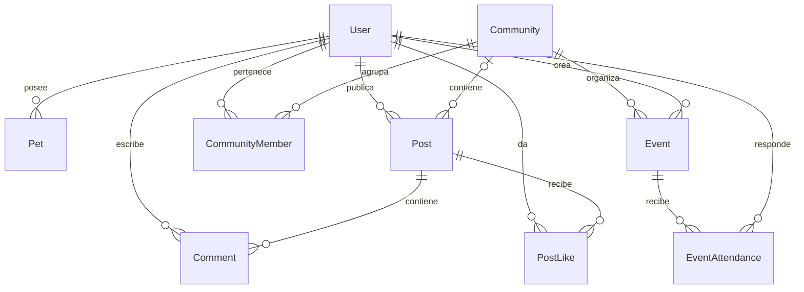

# Petzy — datos y permisos

**Versión documental:** 0.2 · **Revisado:** 1 de octubre de 2026

Inventario transversal de datos y permisos para las capacidades del [mapa](../MAPA-CAPACIDADES.md). Separa el **esquema actual** de las **reglas objetivo**: un modelo o relación existente no implica autorización implementada. Consulte [API.md](API.md) para rutas y [PROYECTO.md](PROYECTO.md) para requisitos. Una propuesta de columna o permiso requiere decisión explícita antes de implementarse.

Al planificar un flujo de la [ruta secuencial](RUTA-DE-DESARROLLO.md), su ficha indica entradas y resultados; esta página muestra las entidades existentes y permisos objetivo. El plan del módulo debe señalar para cada dato su fuente de verdad, relación, dueño, lectura permitida y ciclo de vida. Si una entidad o columna está pendiente, anotarla como decisión abierta con tipo, nulabilidad y migración prevista antes de escribir código.

## 1. Identidad y fuente de verdad

**Supabase Postgres es la base de datos elegida como destino del proyecto.** El esquema Prisma y las migraciones describen las tablas de aplicación; `DATABASE_URL` decide qué instancia PostgreSQL usa cada entorno. En el entorno local revisado el 29-09-2026 apuntaba a `localhost`; el Compose ofrece esa alternativa local aislada. Supabase Auth autentica por correo y contraseña y emite el token. `User.id` en la base conectada corresponde al identificador de esa identidad. El backend verifica el token y coloca `request.user.id`; los registros propios deben relacionarse con ese ID del servidor.

El perfil de aplicación (`User`) guarda nombre de usuario, avatar, biografía, estado de México, fecha de alta y actividad. `email` también aparece en la tabla, por lo que cualquier cambio de correo debe mantener sincronizados Supabase Auth y el perfil en Postgres. La contraseña no es una columna de `User`; no debe agregarse al DTO de edición de perfil. Se necesita definir el procedimiento para recuperar una creación parcial si Supabase registra la identidad y falla la inserción del perfil.

La decisión D-12 permite cuentas sin filas `Pet`: `User` no requiere una mascota asociada. Feed, comunidades y eventos autorizan por sesión y, según la operación, por membresía o rol; no por existencia de mascotas. No se necesita un rol o columna especial para esta audiencia.

### Qué aporta Supabase y qué existe hoy

| Capacidad | Uso previsto | Estado en el repositorio |
| --- | --- | --- |
| Postgres | Fuente de datos principal de usuarios, mascotas, publicaciones y comunidades. | Esquema Prisma y migraciones; la conexión se elige con `DATABASE_URL`. |
| Auth | Registro, acceso, tokens y recuperación/cambio de credenciales. | Registro e inicio iniciales; recuperación pendiente. |
| Storage | Fotos de perfil, mascotas, publicaciones y comunidades. | Por integrar; hoy se guardan campos de URL, no hay flujo de carga. |
| Data API | CRUD sencillo directo desde la app cuando simplifique el módulo. | No se usa actualmente; la app llama a NestJS. Requiere grants y políticas RLS comprobadas antes de exponerse. |
| Realtime | Actualizaciones en vivo de chat, asistencia o interacciones que lo necesiten. | No se usa actualmente. |

La elección de la herramienta se hace por flujo, no por tabla: aprovechar un servicio de Supabase cuando cubra el caso, y mantener NestJS/Prisma para lógica de dominio, operaciones coordinadas o permisos que resulten más claros en el servidor. Evitar dos caminos de escritura para la misma operación sin una razón documentada.

Cuando una operación pase por NestJS y su conexión Prisma, la API debe seguir comprobando propietario, autor y membresía; no asumir que una política RLS del acceso directo protege automáticamente esa conexión. Cuando pase por la Data API desde la app, definir tanto los permisos de acceso como las políticas RLS y probar casos permitidos y denegados con usuarios diferentes.

## 2. Entidades actuales

| Entidad | Clave y datos importantes | Relación y restricción actual |
| --- | --- | --- |
| `User` | `id: String`, `email` y `username` únicos; `avatar?`, `bio?`, `locatedAt`, `isActive`. | Propietario de mascotas, publicaciones, comentarios y reacciones; miembro de comunidades. |
| `Pet` | `id: Int`, `ownerId: String`, `name`, `age: Int`, `photo?`, `bio?`, `isActive`. | Muchas mascotas pertenecen a un usuario. Faltan `species` y `breed`. |
| `Post` | `id: Int`, `userId`, `communityId?`, `type`, `title`, `description`, `photoUrl?`, `createdAt`, `isActive`. | Autor obligatorio; comunidad opcional. No hay relación con mascota. |
| `Comment` | `id: Int`, `userId`, `postId`, `body`, fechas, `isActive`. | Pertenece a usuario y publicación; índices por publicación/fecha y autor. |
| `PostLike` | Clave compuesta `(userId, postId)`, `createdAt`. | La clave impide dos reacciones iguales de un usuario a una publicación. |
| `Community` | `id: Int`, `name`, `description`, `photoUrl?`. | Tiene miembros y publicaciones; aún no registra tema ni creador explícito. |
| `CommunityMember` | Clave compuesta `(userId, communityId)`, `role`, `joinedAt`. | La clave impide membresías duplicadas. Roles: `ADMIN`, `MODERATOR`, `MEMBER`. |
| `Event` | `id`, `communityId`, `creatorId`, título, descripción, portada opcional, inicio/fin, zona, lugar, coordenadas, estado y fechas. | FK a comunidad y creador; índices por comunidad/estado/inicio. Migración aplicada a PostgreSQL local; Supabase pendiente. |
| `EventAttendance` | Clave `(eventId, userId)`, estado `GOING`/`NOT_GOING`, fecha de respuesta. | Una respuesta vigente por usuario/evento; índice por evento/estado. Migración aplicada a PostgreSQL local; Supabase pendiente. |

`Post.type` admite `GENERAL`, `TIP`, `QUESTION` y `LOST_PET`. `User.locatedAt` es un estado del enum `MexicoState`, no una ubicación GPS. Los modelos y tablas de eventos/asistencia existen en la base local revisada; falta desplegar la migración en Supabase. No hay modelos de conversaciones, mensajes ni adopción. Adopción pertenece al MVP después del chat privado; su modelo, relaciones y permisos concretos se decidirán al revisar [la ficha](ESPECIFICACIONES/ADOPCION.md). No se añaden campos de precio o pago en el MVP.

## 3. Relaciones y lectura de contenido

La relación de `Post` con `Community` es opcional. Como regla objetivo, `communityId = null` identifica el feed general; un ID presente identifica el mini-feed de esa comunidad. El endpoint actual `GET /posts` todavía mezcla ambos casos, de modo que la separación requiere código y pruebas.

Las columnas `isActive` de usuario, mascota, publicación y comentario permiten desactivación lógica. Las consultas públicas deben filtrar registros inactivos y definir cómo se presenta contenido histórico cuando se desactiva su autor o mascota. Actualmente esa regla no se aplica de forma uniforme a todos los endpoints.

## 4. Matriz de permisos objetivo

| Recurso y operación | Visitante | Usuario autenticado | Propietario / autor | Admin o moderador de comunidad |
| --- | --- | --- | --- | --- |
| Registrarse e iniciar sesión | Sí | Sí | — | — |
| Ver perfil público y buscar usuarios | No por ahora | Sí, campos públicos | Sí, también sus datos privados | Igual que usuario, sin acceso especial al correo |
| Editar perfil o cerrar su cuenta | No | No para cuentas ajenas | Sí, su propia cuenta | No para cuentas ajenas |
| Ver mascotas | No | Sí, mascotas activas relacionadas con perfiles visibles a usuarios registrados; campos exactos pendientes | Sí | Sin privilegio adicional |
| Crear, editar o desactivar mascota | No | Crear una propia | Editar/desactivar una propia | Sin privilegio adicional |
| Leer feed y detalle | No por ahora | Sí, contenido activo visible | Sí | Sí, según visibilidad de comunidad |
| Crear publicación general | No | Sí | — | — |
| Editar o desactivar publicación | No | No la ajena | Sí | Moderación de comunidad por definir, con registro de la acción |
| Comentar y reaccionar | No | Sí, en contenido visible y activo | Editar/desactivar comentario propio | Moderación por definir |
| Crear comunidad | No | Sí; se convierte en `ADMIN` | — | — |
| Unirse o salir de comunidad | No | Sí, según reglas de ingreso | — | Admin gestiona membresías según política |
| Publicar en comunidad | No | Solo si es miembro | Puede editar su publicación | Admin/moderador puede moderar según política |
| Crear evento de comunidad | No | `MEMBER` no puede | Si tiene rol `ADMIN` o `MODERATOR` | Sí, en su comunidad; comprobar rol en la API |
| Ver evento y responder asistencia | No por ahora | Puede ver; confirma solo si es miembro de la comunidad | Igual | Igual; sin respuesta duplicada ni lista nominal pública |
| Editar datos o roles de comunidad | No | No | — | Solo roles autorizados; `MEMBER` no administra |
| Leer y crear publicaciones de adopción | No por ahora | Sí; puede crear sin ficha `Pet` propia | Sí | Sin privilegio adicional confirmado |
| Marcar que la mascota encontró hogar | No | No en publicación ajena | Sí, solo el autor | Moderación adicional por definir |
| Contactar al autor de adopción | No | Sí, mediante chat privado uno a uno | Comportamiento en publicación propia pendiente | Sin privilegio adicional |

Esta matriz es **objetivo**, no certificación del backend. Toda decisión de autorización se comprueba en la API y se vuelve a probar con dos cuentas distintas. Ocultar botones en la app mejora la interfaz, pero no reemplaza el control del servidor.

## 5. Cambios de esquema antes de cada módulo

### Perfil

- Los perfiles y mascotas activas son visibles para usuarios registrados. Definir los campos generales concretos; `email`, credenciales y tokens quedan privados.
- Separar el DTO de edición de perfil del DTO de registro. Actualizar correo/contraseña mediante Supabase Auth y sincronizar el perfil con una política de recuperación ante fallas.
- Establecer si «desactivar cuenta» permite reactivación y qué ocurre con sus mascotas, publicaciones y membresías.

### Mascotas

- Añadir `species` y `breed?`; elegir si especie será catálogo/enum o texto controlado. No imponer un catálogo de razas hasta decidir cómo tratar mestizos y razas desconocidas.
- Sustituir `age: Int` por una fecha de nacimiento y calcular la edad al mostrarla. Revisar los registros anteriores: una edad numérica no permite reconstruir la fecha exacta sin información del dueño.
- Conservar `ownerId` como relación obligatoria y asignarlo desde el token; retirarlo del cuerpo de creación y edición.
- Validar foto, tamaño y formato en el servicio de archivos elegido. La base almacena la referencia.

### Feed

- Decidir si `Post` necesita `petId?`; si se añade, comprobar que la mascota pertenece al autor al crear o editar la publicación.
- Separar feed general de mini-feed por `communityId` y paginar por un orden estable (`createdAt` más `id`, por ejemplo).
- Verificar que el autor de un comentario o reacción sea el usuario del token y que la publicación esté activa y sea visible para él.
- Mantener la unicidad de `PostLike` y definir qué se hace con comentarios y reacciones al desactivar una publicación.

### Comunidades

- Añadir tema/categoría si la exploración temática es requisito de la primera entrega.
- Crear `Community` y su `CommunityMember(ADMIN)` en una misma transacción para evitar comunidades sin administrador.
- Definir público/privado, ingreso, salida del último administrador, cesión del rol y facultades exactas de `MODERATOR`.
- Al crear una publicación comunitaria, comprobar membresía y visibilidad en el servidor; no confiar solo en `communityId`.
- En el detalle de cada comunidad separar «Publicaciones» (`Post.communityId`) de «Eventos» (`Event.communityId`). Solo `ADMIN` y `MODERATOR` pueden crear eventos; comprobar su rol en el servidor.

## 6. Modelos pendientes: chat y adopción en el MVP; eventos después

**Eventos:** `Event` pertenece obligatoriamente a `Community` y guarda creador, título, descripción, portada opcional, fecha/hora con zona horaria, lugar, latitud, longitud y estado. `EventAttendance` tiene clave compuesta `(eventId, userId)` y decisión vigente. El conteo de «Iré» se obtiene de las respuestas `GOING`. El código exige membresía para confirmar; creador y `ADMIN` pueden editar/cancelar según D-09. La migración consta aplicada a la base local, no verificada en Supabase. Véase [ESPECIFICACIONES/COMUNIDADES-EVENTOS.md](ESPECIFICACIONES/COMUNIDADES-EVENTOS.md).

**Chat privado:** `Conversation` debe representar un par de usuarios sin duplicados, y `Message` debe guardar conversación, remitente, contenido, fecha y estado. La API comprobará que el remitente y quien lee pertenezcan a la conversación. Bloqueo, reporte, borrado y retención se definen antes de abrirlo a usuarios reales.

**Adopción:** se integra después del chat uno a uno. Su fuente de datos aún no está decidida: revisar si se reutiliza `Post` o se necesita otro modelo, manteniendo el apartado separado del feed general y comunitario. El autor del token publica y es el único que puede indicar que la mascota encontró hogar; cualquier persona registrada puede publicar sin ficha `Pet` propia. Definir transición de estado, moderación y prevención de ventas antes de añadir columnas o API. No incluir precio ni pagos en el MVP. Véase [ADOPCION.md](ESPECIFICACIONES/ADOPCION.md).

Los chats grupales y la CNN quedan fuera de esta primera estructura. Si se implementa la CNN, la raza sugerida será editable y distinguible de un dato confirmado por el dueño.

## 7. Brechas de permisos detectadas en el código actual

- `POST/PATCH/DELETE /pet` no comprueban aún que el solicitante sea el dueño. El DTO de mascota valida `ownerId` con `@IsInt()` pese a que es `String` en Prisma.
- `PATCH/DELETE /user/:id` no limitan la operación a la cuenta autenticada. El DTO de edición hereda `password`, aunque `User` no tiene esa columna.
- `GET /user/search` devuelve usuarios completos y puede exponer correo. `GET /user/:id/pets` acepta cualquier ID y no filtra mascotas inactivas.
- `POST /posts` admite `communityId` sin comprobar membresía. `GET /posts` no separa feed general y comunidades.
- El guard de propietario de comentarios tiene una validación de ID que debe corregirse antes de considerar protegida la edición o eliminación.
- El guard global verifica la firma del token, pero su configuración actual no establece comprobaciones explícitas de emisor y audiencia. Revisar estos valores con la configuración de Supabase antes de publicar la API.

## 8. Migraciones y verificación por módulo

Cada cambio de modelo debe tener una migración versionada y una actualización del contrato de API. En desarrollo, aplicar `prisma migrate dev` y ejecutar después `prisma generate` de forma explícita. Revisar el SQL cuando se cambien campos obligatorios o relaciones con datos existentes.

Pruebas mínimas de permisos con dos cuentas: A crea el recurso; B intenta editarlo y debe recibir una denegación; A lo edita; al desactivarlo deja de aparecer en los listados normales. Para comunidades, probar miembro y no miembro. Los resultados y las excepciones se anotarán en este documento al completar cada módulo.

## 9. Referencias oficiales de Supabase

- [Conectar Prisma con Supabase Postgres](https://supabase.com/docs/guides/database/prisma).
- [Data API generada desde PostgreSQL](https://supabase.com/docs/guides/api) y [seguridad con permisos y RLS](https://supabase.com/docs/guides/api/securing-your-api).
- [Supabase Storage](https://supabase.com/docs/guides/storage) para archivos e imágenes.
- [Supabase Realtime](https://supabase.com/docs/guides/realtime) para eventos en vivo.
